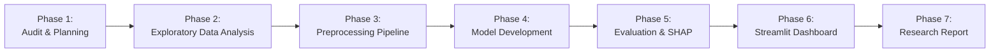

# AirSense — Implementation Roadmap

**Project:** AirSense — Air Quality Prediction and Analysis Using Machine Learning  
**Workspace:** `C:\dev\AirSense\`  
**Target:** 4-Model Comparative Multi-Class Air Quality Classification & Dashboard  
**Status:** Phase 1 Complete (Awaiting User Review)  

---

## Roadmap Overview

---

## Phase 1: Workspace Foundation & Dataset Audit (COMPLETED)
- **Status:** **Completed**
- **Core Objectives:**
  - Audit workspace environment and directory contents.
  - Empirically examine the 5 CSV files in `data/raw/archive (3)/`.
  - Verify presence/absence of weather variables, target columns, and CPCB standard boundaries.
  - Define system architecture, model suite, target variables, and quality constraints.
- **Deliverables:**
  - `PROJECT_PLAN.md`
  - `REQUIREMENTS.md` & `requirements.txt`
  - `IMPLEMENTATION_ROADMAP.md`
  - `reports/dataset_requirements.md`
  - `docs/IMPLEMENTATION_LOG.md`, `docs/AI_PROMPT_LOG.md`, `docs/AI_FAILURE_LOG.md`
- **Verification Gate:**
  - Raw files confirmed unedited.
  - Zero weather variables confirmed across all schemas.
  - CPCB categories documented.

---

## Phase 2: Exploratory Data Analysis (EDA) & Domain Investigation
- **Target Status:** Pending Review & Approval
- **Core Objectives:**
  - Profile individual pollutant distributions (skewness, kurtosis, log-normal behavior).
  - Analyze missingness mechanisms across cities and years.
  - Generate correlation heatmaps between criteria pollutants ($PM_{2.5}, PM_{10}, NO_2, SO_2, CO, O_3$).
  - Investigate severe air quality episodes (e.g., Delhi winter smog, festival surges).
  - Study class distributions and geographic disparities across the 26 cities.
- **Key Deliverables:**
  - `src/eda/run_eda.py`: Automated reproducible EDA script.
  - Publication-ready charts saved to `reports/figures/`:
    - `pollutant_distributions.png`
    - `correlation_matrix.png`
    - `city_aqi_comparison.png`
    - `aqi_bucket_imbalance.png`
    - `seasonal_trend_analysis.png`
- **Verification Gate:**
  - Visual artifacts accurately reflect ground-truth counts from `city_day.csv`.
  - Outlier bounds and high-skew characteristics noted.

---

## Phase 3: Data Preprocessing & Leakage-Free Pipeline
- **Target Status:** Planned
- **Core Objectives:**
  - Filter unlabeled samples (rows missing `AQI_Bucket`).
  - Perform stratified train/validation/test split ($70\% / 15\% / 15\%$) using fixed seed (`42`).
  - Implement spatial/temporal median imputation inside a pipeline to guarantee zero data leakage from test sets.
  - Extract safe calendar features (`Month`, `Season`, `DayOfWeek`).
  - Encode categorical targets into integer labels ($0$ to $5$ matching CPCB order).
  - Fit and persist `RobustScaler` or `StandardScaler` for distance/margin-sensitive algorithms (SVM).
- **Key Deliverables:**
  - `src/data/preprocess.py`
  - `models/preprocessor.joblib`
  - `data/processed/train.parquet` (or `.csv`), `val.parquet`, `test.parquet`
- **Verification Gate:**
  - Target `AQI` column strictly excluded from feature matrix $X$.
  - Test set transformations use fitted parameters strictly from train fold.

---

## Phase 4: Model Development & Hyperparameter Tuning
- **Target Status:** Planned
- **Core Objectives:**
  - Train and optimize the four required algorithms:
    1. **Decision Tree Classifier:** Baseline interpretable tree, tuned for `max_depth` and `min_samples_leaf`.
    2. **Random Forest Classifier:** Bagging ensemble with `class_weight='balanced'` to counter category skew.
    3. **Support Vector Machine (SVM):** Kernel classifier (RBF), scaled inputs, probability calibration.
    4. **XGBoost Classifier:** Extreme gradient boosted trees with `multi:softprob` objective.
  - Perform stratified k-fold cross-validation ($k=5$) for hyperparameter selection.
- **Key Deliverables:**
  - `src/models/train_dt.py`
  - `src/models/train_rf.py`
  - `src/models/train_svm.py`
  - `src/models/train_xgboost.py`
  - Saved model weights in `models/` directory (`dt_model.joblib`, `rf_model.joblib`, etc.)
- **Verification Gate:**
  - All four models train without convergence errors.
  - Random seed fixed across all estimators.

---

## Phase 5: Evaluation, Multi-Class Benchmarking & SHAP Explainability
- **Target Status:** Planned
- **Core Objectives:**
  - Evaluate all 4 models on the held-out test split under identical conditions.
  - Compute multi-class metrics: Macro F1, Weighted F1, Macro Recall, Macro Precision, Balanced Accuracy, and overall Accuracy.
  - Generate multi-class Confusion Matrices for each algorithm.
  - Conduct SHAP (SHapley Additive exPlanations) analysis:
    - Compute SHAP values for Tree models (Random Forest and XGBoost).
    - Generate Global Feature Importance summary plot (beeswarm and bar).
    - Generate local waterfall plots for representative `Severe` vs `Good` air quality days.
- **Key Deliverables:**
  - `reports/evaluation_results.md`
  - Figures in `reports/figures/`:
    - `confusion_matrices_comparison.png`
    - `model_metrics_barchart.png`
    - `shap_summary_rf.png`
    - `shap_summary_xgb.png`
- **Verification Gate:**
  - Tabulated comparisons show zero metric inflation or rounding contradictions.
  - Feature ranking clearly reflects dominant driving pollutants (e.g., $PM_{2.5}, PM_{10}, NO_2$).

---

## Phase 6: Streamlit Interactive Dashboard
- **Target Status:** Planned
- **Core Objectives:**
  - Develop an intuitive multi-page or tabbed Streamlit dashboard (`app.py`).
  - **Module 1: Historical Air Quality Explorer:** City-level time-series trends, seasonal charts, and CPCB category distribution.
  - **Module 2: Model Benchmark Arena:** Interactive comparative table, confusion matrix inspection, and performance trade-off analysis.
  - **Module 3: Live AQI Category Classifier:** Interactive sliders for pollutant levels ($PM_{2.5}, PM_{10}, NO_2, SO_2, CO, O_3$), instant prediction across all 4 models, and probability distribution visualization.
- **Key Deliverables:**
  - `app.py`
  - `src/dashboard/` helper components
- **Verification Gate:**
  - Streamlit app starts cleanly with `streamlit run app.py` on `localhost:8501`.
  - UI inputs bound to valid CPCB concentration ranges with clear tooltips.

---

## Phase 7: Research-Style Report & Final Synthesis
- **Target Status:** Planned
- **Core Objectives:**
  - Write a comprehensive academic report (`reports/research_report.md`).
  - Contextualize findings with the literature review of Méndez et al. (2023).
  - Discuss algorithmic trade-offs (interpretability vs. non-linear capacity, computational cost).
  - Document operational public health implications and limitations (lack of weather data, extreme pollution spikes).
- **Key Deliverables:**
  - `reports/research_report.md`
  - Complete project repository with finalized documentation logs.
- **Verification Gate:**
  - Citations match DOI: 10.1007/s10462-023-10424-4.
  - Report clearly distinguishes classification vs. forecasting.

