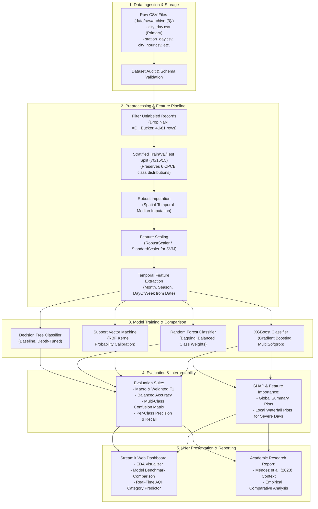

# AirSense — Project Plan & Architecture

**Project Title:** AirSense — Air Quality Prediction and Analysis Using Machine Learning  
**Project Workspace:** `C:\dev\AirSense\`  
**Primary Dataset:** India Air Quality Dataset (2015–2020), Kaggle (Rohan Rao)  
**Primary Research Reference:** Méndez, M., Merayo, M. G., & Núñez, M. (2023). *Machine learning algorithms to forecast air quality: a survey.* Artificial Intelligence Review, 56, 10031–10066. https://doi.org/10.1007/s10462-023-10424-4  
**Status:** Planning & Inception Phase (Stage 1 Complete)  

---

## 1. Project Overview & Objectives

Air pollution is a major environmental and public health crisis across urban centers in India. Reliable characterization of ambient air quality into actionable advisory tiers (such as the Central Pollution Control Board's National Air Quality Index categories) is vital for public awareness and municipal mitigation policies.

### 1.1 Core Objectives
1. **Empirical Algorithm Comparison:** Implement, optimize, and rigorously compare four distinct machine learning architectures for multi-class air-quality classification (`AQI_Bucket`):
   - **Decision Tree (DT):** Interpretable baseline tree model.
   - **Random Forest (RF):** Bagging ensemble reducing variance and capturing non-linear feature interactions.
   - **Support Vector Machine (SVM):** Margin-maximizing kernel-based classifier.
   - **XGBoost:** Scalable gradient boosted decision tree framework optimizing regularized loss.
2. **Exploratory Data Analysis (EDA):** Quantify multi-city pollutant distributions, seasonal variations, inter-pollutant collinearities, and severe pollution patterns.
3. **Rigorous & Fair Evaluation:** Evaluate all models on identical stratified validation splits using multi-class metrics (Macro F1, Weighted F1, Class-wise Recall, Balanced Accuracy, and Confusion Matrices) to account for significant class imbalance.
4. **Model Explainability:** Utilize Tree Feature Importances and SHAP (SHapley Additive exPlanations) to interpret which pollutants drive classification decisions into hazardous tiers (`Poor`, `Very Poor`, `Severe`).
5. **Interactive Streamlit Dashboard:** Build an intuitive, interactive web application allowing users to explore historical trends, simulate pollutant concentration scenarios, and inspect model predictions in real time.
6. **Research-Style Technical Report:** Author an academic report contextualized against the literature review of Méndez et al. (2023) and our experimental results on the Indian monitoring network.

---

## 2. Theoretical Grounding & Literature Alignment

### 2.1 Insights from Méndez et al. (2023)
Méndez, Merayo, and Núñez (2023) reviewed 155 research papers published between 2011 and 2021 regarding machine learning applications in air quality assessment. Key takeaways relevant to AirSense include:
- **Algorithm Taxonomy:** The survey identifies Decision Trees, Random Forests, Support Vector Machines/Regression, and Gradient Boosting algorithms (including XGBoost) as the standard, widely cited classical and ensemble machine learning paradigms for environmental modeling.
- **Predictor Variables:** While international studies frequently combine pollutant concentrations with meteorological features (temperature, humidity, wind velocity, atmospheric pressure), many real-world operational datasets—including the CPCB monitoring dataset—often contain pollutant measurements alone.
- **Evaluation Practices:** Méndez et al. emphasize that model comparisons must use standardized metrics and strict train/test segregation to prevent optimistic bias and leakage.

### 2.2 Strict Delineation: Classification vs. Forecasting
- **Survey Scope:** The paper by Méndez et al. surveys *forecasting* models (predicting future pollutant levels $y_{t+h}$ given history up to time $t$).
- **AirSense Experimental Scope:** In our primary experiment, we address **air-quality category classification** (mapping current monitored multi-pollutant concentrations at time $t$ to the official CPCB health category `AQI_Bucket` at time $t$).
- **Methodological Principle:** In strict adherence to project rules, **current-condition classification is never claimed or reported as future forecasting**. It represents diagnostic classification and automated health advisory categorization.

---

## 3. End-to-End System Architecture

---

## 4. Dataset Files & Primary Data Selection

As documented in `reports/dataset_requirements.md`, the raw dataset provides 5 distinct CSV files:
1. `stations.csv` (230 monitoring station records across 127 cities)
2. `city_day.csv` (29,531 daily city-level records across 26 cities)
3. `city_hour.csv` (707,875 hourly city-level records)
4. `station_day.csv` (108,035 daily station-level records across 110 stations)
5. `station_hour.csv` (2,589,083 hourly station-level records)

### Primary Selection: `city_day.csv`
- **Justification:**
  - Standardizes air quality at the municipal level, reflecting how CPCB communicates AQI health warnings to the public.
  - 24,850 labeled records provide ample statistical power for training complex non-linear models (Random Forest, XGBoost) while remaining computationally tractable for kernel SVM ($O(N^2)$ to $O(N^3)$ computational complexity).
  - Daily aggregation mitigates extreme short-term sensor glitches without losing seasonal trends.
- **Station-Level Auxiliary Role:** `station_day.csv` and `stations.csv` will be leveraged for spatial station mapping and regional microclimate analysis in the EDA stage.

---

## 5. Target Column & Feature Space Formulation

### 5.1 Primary Target: `AQI_Bucket` (Multi-Class Classification)
The ground-truth classification target is `AQI_Bucket`, containing 6 ordinal categories:
1. `Good` (AQI 0–50)
2. `Satisfactory` (AQI 51–100)
3. `Moderate` (AQI 101–200)
4. `Poor` (AQI 201–300)
5. `Very Poor` (AQI 301–400)
6. `Severe` (AQI 401–500+)

### 5.2 Input Feature Matrix ($X$)
To strictly prevent data leakage, the continuous `AQI` column is **strictly excluded** from features, because `AQI` is mathematically derived from the pollutants:
- **Core Particulate Features:** `PM2.5`, `PM10`
- **Gaseous Pollutants:** `NO`, `NO2`, `NOx`, `NH3`, `CO`, `SO2`, `O3`
- **Volatile Organic Compounds (VOCs):** `Benzene`, `Toluene`, `Xylene` (with missingness ablation)
- **Engineered Temporal Features:** `Month`, `Season` (Winter, Pre-monsoon, Monsoon, Post-monsoon), `DayOfWeek` derived strictly from `Date`.
- **Weather Features:** **None.** (Zero weather variables exist in the raw dataset).

---

## 6. Implementation Stages & Milestones

| Stage | Name | Key Deliverables | Verification Criteria |
| :---: | :--- | :--- | :--- |
| **1** | **Workspace Foundation & Data Audit** | `PROJECT_PLAN.md`, `REQUIREMENTS.md`, `IMPLEMENTATION_ROADMAP.md`, `reports/dataset_requirements.md`, docs logs | Workspace verified, raw files audited, 0 weather variables confirmed, zero raw file modifications |
| **2** | **Exploratory Data Analysis (EDA)** | `src/eda/`, EDA scripts, visual figures (distributions, heatmaps, time series, city comparisons) | Complete distribution plots, missingness maps, class imbalance quantification, CPCB standard mapping |
| **3** | **Data Preprocessing & Pipeline** | `src/data/`, clean data splitting, reproducible imputation and scaling pipelines | Stratified 70/15/15 split, no data leakage, reproducible pipeline saved to `models/preprocessor.joblib` |
| **4** | **Model Training & Comparison** | `src/models/`, scripts for DT, RF, SVM, XGBoost training and cross-validation | 4 models trained on identical splits with balanced weights, hyperparameters tuned, model artifacts saved |
| **5** | **Evaluation & SHAP Explainability** | `reports/evaluation_results.md`, confusion matrices, SHAP summary and dependence plots | Fair metric table (Macro F1, Recall, Precision, Accuracy), SHAP feature attribution generated |
| **6** | **Interactive Streamlit Dashboard** | `app.py`, multi-page dashboard with EDA, model comparison, and interactive single-sample prediction | Runs locally via `streamlit run app.py`, clean student-friendly UI, verified working |
| **7** | **Research Report & Documentation** | `reports/research_report.md`, completed implementation logs | Comprehensive academic synthesis citing Méndez et al. (2023) and presenting our empirical findings |

---

## 7. Quality, Reproducibility & Student-Centric Guidelines

- **Simplicity & Readability:** Code will be organized with clear docstrings, intuitive variable names, and explanatory comments suitable for student learning.
- **Logging & Tracking:** Every stage updates `docs/IMPLEMENTATION_LOG.md`, `docs/AI_PROMPT_LOG.md`, and `docs/AI_FAILURE_LOG.md`.
- **Reproducibility:** A fixed random seed (`RANDOM_STATE = 42`) is applied across all train/test splits, cross-validation folds, and stochastic estimators.
- **Safety & Integrity:** Original raw CSVs remain 100% read-only. No external git pushes or unauthorized data substitutions will ever occur.

