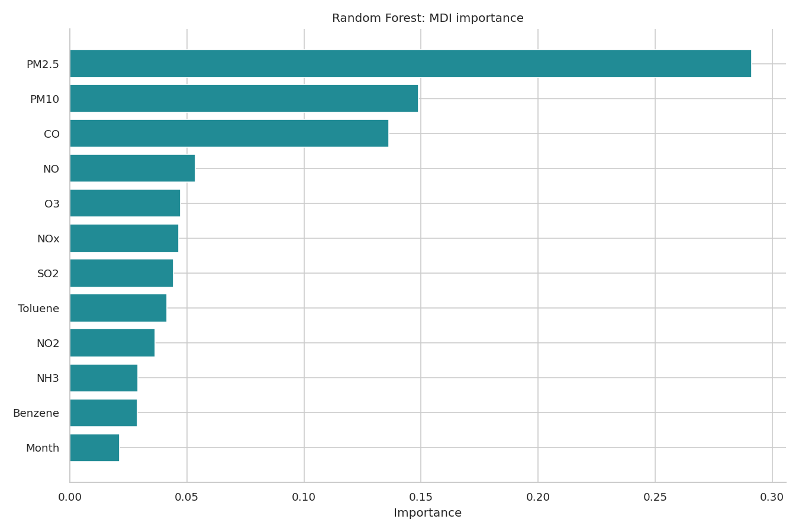
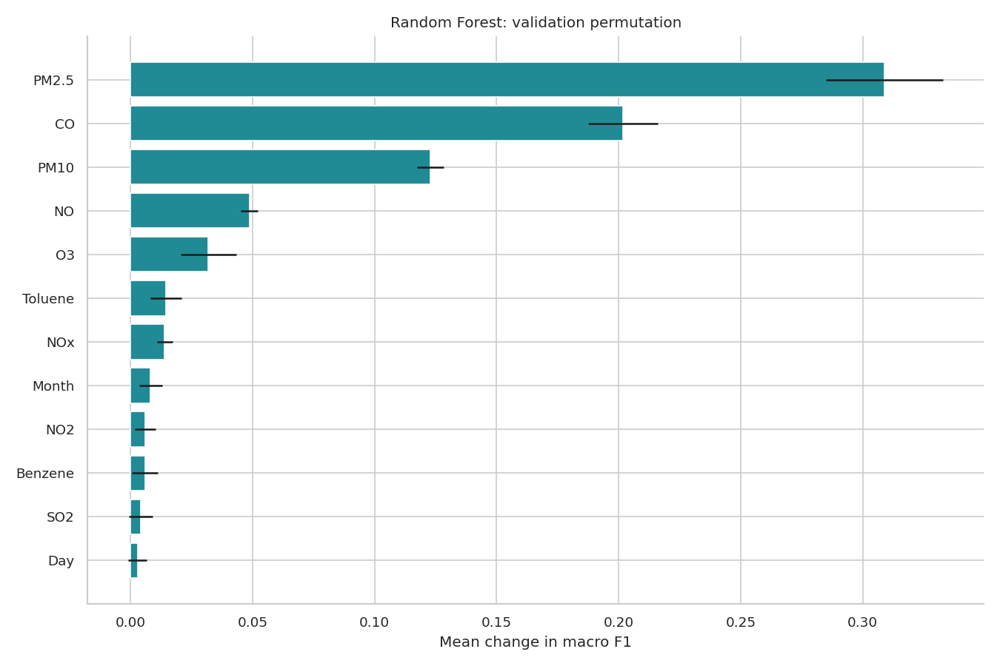
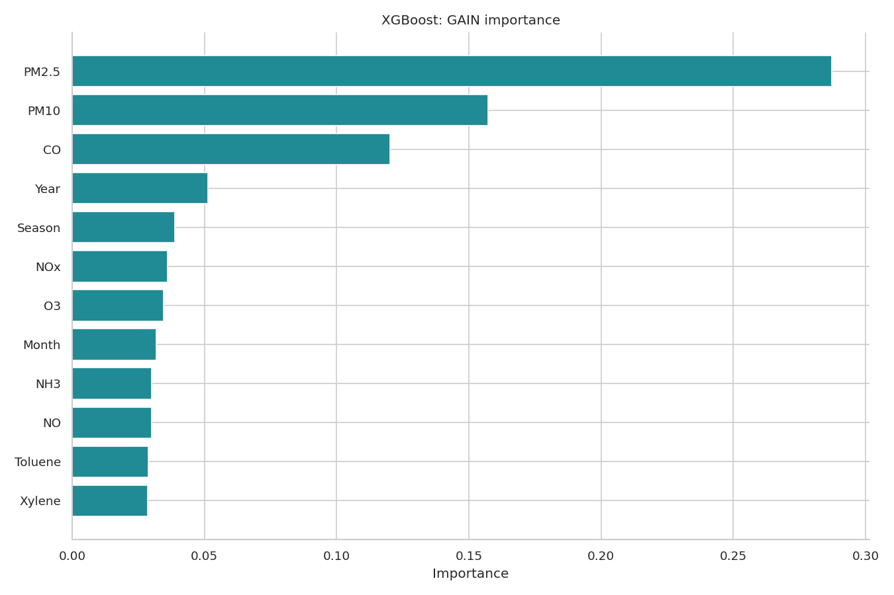
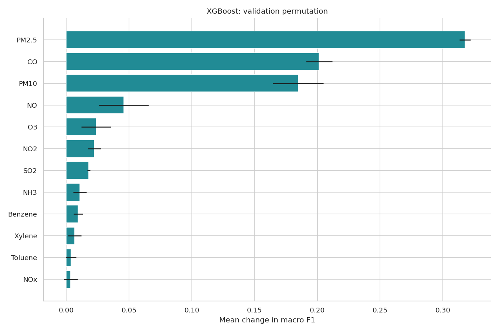
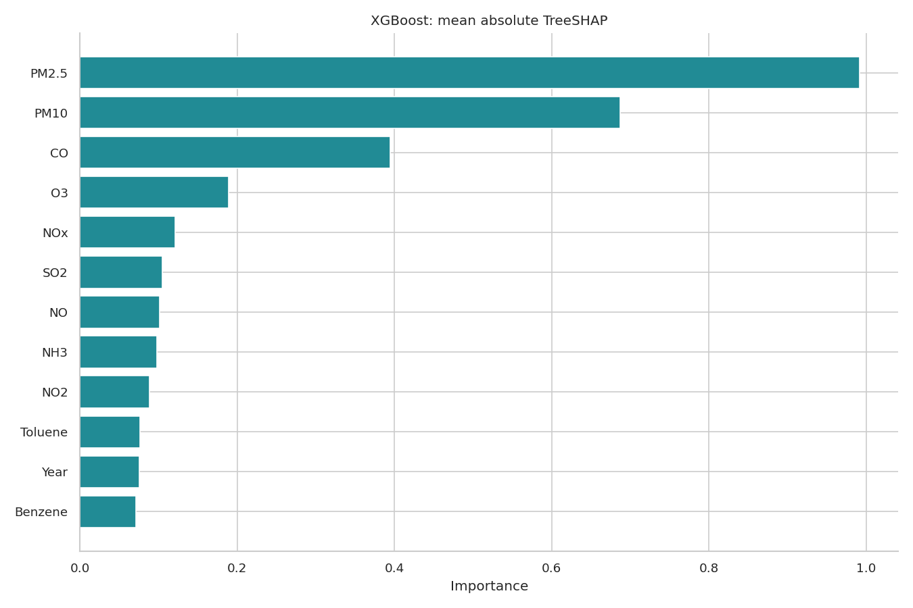

# AirSense — Feature analysis

The uploaded project and the earlier audit had already inspected test outcomes. This corrected rerun is a retrospective benchmark, not a pristine prospective holdout. No test scores are used by the corrected selection/tuning code. New external data is required for an independent final claim.

## Scope and actual settings

Baseline RF and XGBoost pipelines. Permutation: 500 validation rows, 3 repeats, macro F1 across all six classes, seed 42. XGBoost SHAP: 80 training background rows, 120 validation rows. RF SHAP is not attempted to limit computation; RF MDI and permutation are provided. Actual row indices, model hashes, failures and importance CSVs are saved in `reports/feature_analysis/`. Validation was also used for model selection; this analysis is exploratory, not an independent performance estimate. Test rows are not used.

## Predictors

PM2.5, PM10, NO, NO2, NOx, NH3, CO, SO2, O3, Benzene, Toluene, Xylene, Year, Month, Day, DayOfWeek, IsWeekend, Season

City is excluded, so no location-importance conclusion is possible. Weather fields are absent; calendar features do not measure weather effects. Importance is predictive association, not causation.

## Random Forest

### MDI

| feature | importance | type | rank |
| --- | --- | --- | --- |
| PM2.5 | 0.291324 | mdi | 1 |
| PM10 | 0.148957 | mdi | 2 |
| CO | 0.136265 | mdi | 3 |
| NO | 0.053666 | mdi | 4 |
| O3 | 0.047345 | mdi | 5 |
| NOx | 0.046531 | mdi | 6 |
| SO2 | 0.044179 | mdi | 7 |
| Toluene | 0.041381 | mdi | 8 |
| NO2 | 0.036473 | mdi | 9 |
| NH3 | 0.029090 | mdi | 10 |
| Benzene | 0.028844 | mdi | 11 |
| Month | 0.021126 | mdi | 12 |

### Permutation

| feature | importance_mean | importance_std | type | rank |
| --- | --- | --- | --- | --- |
| PM2.5 | 0.308923 | 0.024089 | permutation | 1 |
| CO | 0.201816 | 0.014276 | permutation | 2 |
| PM10 | 0.122789 | 0.005409 | permutation | 3 |
| NO | 0.048743 | 0.003512 | permutation | 4 |
| O3 | 0.031892 | 0.011330 | permutation | 5 |
| Toluene | 0.014574 | 0.006321 | permutation | 6 |
| NOx | 0.014042 | 0.003180 | permutation | 7 |
| Month | 0.008244 | 0.004634 | permutation | 8 |
| NO2 | 0.006003 | 0.004236 | permutation | 9 |
| Benzene | 0.005910 | 0.005264 | permutation | 10 |
| SO2 | 0.004204 | 0.004985 | permutation | 11 |
| Day | 0.002899 | 0.003848 | permutation | 12 |

Largest measured drop: **PM2.5**, 0.3089. Error bars are variation across shuffles, not confidence intervals.

## XGBoost

### GAIN

| feature | importance | type | rank |
| --- | --- | --- | --- |
| PM2.5 | 0.287127 | gain | 1 |
| PM10 | 0.157124 | gain | 2 |
| CO | 0.120251 | gain | 3 |
| Year | 0.051340 | gain | 4 |
| Season | 0.038832 | gain | 5 |
| NOx | 0.035986 | gain | 6 |
| O3 | 0.034406 | gain | 7 |
| Month | 0.031838 | gain | 8 |
| NH3 | 0.029969 | gain | 9 |
| NO | 0.029897 | gain | 10 |
| Toluene | 0.028841 | gain | 11 |
| Xylene | 0.028485 | gain | 12 |

### Permutation

| feature | importance_mean | importance_std | type | rank |
| --- | --- | --- | --- | --- |
| PM2.5 | 0.317674 | 0.004454 | permutation | 1 |
| CO | 0.201383 | 0.010508 | permutation | 2 |
| PM10 | 0.184710 | 0.020091 | permutation | 3 |
| NO | 0.045744 | 0.019970 | permutation | 4 |
| O3 | 0.023842 | 0.011724 | permutation | 5 |
| NO2 | 0.022351 | 0.005181 | permutation | 6 |
| SO2 | 0.018018 | 0.001159 | permutation | 7 |
| NH3 | 0.010907 | 0.005353 | permutation | 8 |
| Benzene | 0.009391 | 0.003713 | permutation | 9 |
| Xylene | 0.006747 | 0.005343 | permutation | 10 |
| Toluene | 0.003864 | 0.004144 | permutation | 11 |
| NOx | 0.003549 | 0.005373 | permutation | 12 |

Largest measured drop: **PM2.5**, 0.3177. Error bars are variation across shuffles, not confidence intervals.

### SHAP

| feature | importance |
| --- | --- |
| PM2.5 | 0.991310 |
| PM10 | 0.686987 |
| CO | 0.394725 |
| O3 | 0.189424 |
| NOx | 0.121016 |
| SO2 | 0.105068 |
| NO | 0.101035 |
| NH3 | 0.098196 |
| NO2 | 0.088370 |
| Toluene | 0.076386 |
| Year | 0.075952 |
| Benzene | 0.071377 |

Mean absolute interventional TreeSHAP is averaged over validation rows and classes in raw margin units, not probability changes. Training background defines the reference distribution.

## Measured training correlations

| feature_1 | feature_2 | training_spearman_rho |
| --- | --- | --- |
| PM2.5 | PM10 | 0.859869 |
| DayOfWeek | IsWeekend | 0.791581 |
| Benzene | Toluene | 0.790106 |
| NO | NOx | 0.746528 |
| Benzene | Xylene | 0.650742 |
| NO2 | NOx | 0.646297 |
| PM10 | NOx | 0.576751 |
| PM10 | NO | 0.564667 |
| NO | NO2 | 0.555489 |
| Toluene | Xylene | 0.541176 |

MDI can favor variables with many possible splits. Gain is model-specific. Correlated features can substitute for each other, lowering single-feature permutation importance; shuffling can also produce unrealistic pollutant combinations. SHAP depends on the background and feature-dependence assumptions and does not resolve confounding. Calendar covariates are correlated by construction. No NOx identity or numerical correlation is assumed without measuring the supplied data. Contemporaneous pollutants help define AQI, so their importance partly reflects the target construction. Missingness, sensor coverage, selection of labeled city-days and temporal drift can bias importance. Only two baseline models and a small validation sample are analyzed; stability across periods/seeds and geographic transfer remain untested.

## Primary-survey context

Méndez, Merayo & Núñez (2023), Machine learning algorithms to forecast air quality: a survey. https://doi.org/10.1007/s10462-023-10424-4 (publisher verified 2026-11-01). Section 3.3 discusses predictor groups, including pollutant and weather variables. Section 3.4 distinguishes metric types and reports widespread use of RMSE/MSE and MAE as well as ACC, R² and MAPE. AirSense instead evaluates six-class, same-day AQI classification using macro F1 and per-class errors. Chronological splitting and macro-F1 selection here are our experimental choices, not attributed recommendations from the survey. Datasets, targets, horizons, splits and metrics differ, so our scores are not directly comparable with published scores. No universal ensemble advantage or macro-F1 recommendation is attributed to this survey.

The survey's predictor taxonomy motivates documenting available inputs. These importance results cannot establish what absent weather inputs would contribute. No additional unverified references are cited.

## Reproduce

`python -m scripts.analyze_features` after training. Install the declared SHAP dependency to attempt SHAP; unsupported explanations are recorded as failures.