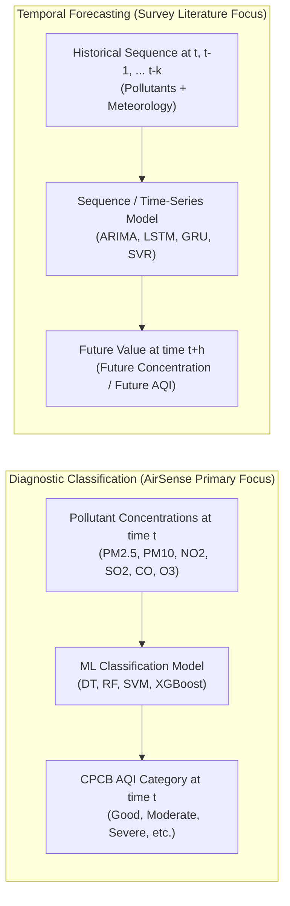

# AirSense — Comprehensive Literature Review

**Project:** AirSense — Air Quality Prediction and Analysis Using Machine Learning  
**Primary Reference:** Méndez, M., Merayo, M. G., & Núñez, M. (2023). *Machine learning algorithms to forecast air quality: a survey.* **Artificial Intelligence Review**, 56(9), 10031–10066. https://doi.org/10.1007/s10462-023-10424-4  
**Regulatory Foundation:** Central Pollution Control Board (CPCB) National Air Quality Index (NAQI) Standards, India (2014/2015)  
**Author:** AI Assistant (Antigravity) & Student Research Team  

---

## 1. Air Pollution & Its Health and Environmental Relevance

Air pollution represents one of the most pressing environmental health challenges of modern civilization. Rapid industrial expansion, urban population growth, high-density vehicular traffic, fossil-fuel-based power generation, and seasonal biomass burning have dramatically increased the concentration of hazardous airborne toxins.

According to the World Health Organization (WHO, 2021), ambient air pollution causes an estimated 4.2 million premature deaths globally each year due to stroke, ischemic heart disease, chronic obstructive pulmonary disease (COPD), lung cancer, and acute lower respiratory infections. In developing and rapidly urbanizing nations like India, the burden is particularly acute. The Indo-Gangetic Plain frequently experiences hazardous pollution episodes during winter months due to thermal inversion layers, low wind dispersion, and regional crop residue combustion.

The health impact of air pollution depends strongly on particle size and chemical composition:
- **Particulate Matter ($PM_{2.5}$ and $PM_{10}$):** Fine inhalable particles with diameters $\le 2.5\,\mu\text{m}$ ($PM_{2.5}$) penetrate deep into lung alveoli and cross into the bloodstream, triggering systemic cardiovascular inflammation and cellular oxidative stress. Coarse particles ($PM_{10}$) deposit primarily in the upper respiratory tract.
- **Nitrogen Oxides ($NO_x$, $NO_2$):** Toxic combustion by-products that cause airway inflammation, exacerbate bronchial asthma, and serve as precursors to secondary particle and tropospheric ozone formation.
- **Sulfur Dioxide ($SO_2$):** Produced from sulfur-bearing fossil fuel combustion in thermal power plants and refineries; causes bronchoconstriction and acid precipitation.
- **Ozone ($O_3$):** A secondary ground-level photochemical oxidant created by solar irradiance reacting with $NO_x$ and volatile organic compounds; causes lung tissue damage and reduces agricultural crop yields.
- **Carbon Monoxide ($CO$):** Competitively binds to blood hemoglobin forming carboxyhemoglobin, reducing oxygen-carrying capacity.

---

## 2. Air Quality Index (AQI) & Pollutant Measurements

To translate complex multi-pollutant concentrations ($\mu\text{g}/\text{m}^3$ and $\text{mg}/\text{m}^3$) into an accessible metric for the general public and policymakers, environmental protection authorities define an **Air Quality Index (AQI)**.

In India, the Central Pollution Control Board (CPCB) introduced the National Air Quality Index (NAQI) in 2014, adopting a "One Number- One Colour-One Description" communication paradigm. The CPCB NAQI considers eight criteria pollutants: $PM_{2.5}, PM_{10}, NO_2, SO_2, CO, O_3, NH_3,$ and Lead ($Pb$).

### CPCB Sub-Index Formulation
For each monitored pollutant $p$, a sub-index $I_p$ is calculated using segmented linear interpolation across concentration breakpoints:

$$I_p = I_{lo} + \frac{I_{hi} - I_{lo}}{B_{hi} - B_{lo}} (C_p - B_{lo})$$

where:
- $C_p$ is the observed 24-hour average concentration (or 8-hour for $CO$ and $O_3$),
- $[B_{lo}, B_{hi}]$ is the concentration breakpoint bracket encompassing $C_p$,
- $[I_{lo}, I_{hi}]$ is the corresponding AQI breakpoint category range.

The overall aggregate $\text{AQI}$ is dictated by the **maximum sub-index** among all monitored pollutants, provided at least three pollutants are measured and at least one is either $PM_{2.5}$ or $PM_{10}$:

$$\text{AQI} = \max(I_1, I_2, \dots, I_k), \quad k \ge 3$$

The resulting index is partitioned into six health risk categories (`AQI_Bucket`):
1. **Good (0–50):** Minimal impact.
2. **Satisfactory (51–100):** Minor breathing discomfort to sensitive people.
3. **Moderate (101–200):** Breathing discomfort to people with lungs, asthma, and heart diseases.
4. **Poor (201–300):** Breathing discomfort to most people on prolonged exposure.
5. **Very Poor (301–400):** Respiratory illness on prolonged exposure.
6. **Severe (401–500+):** Affects healthy people and seriously impacts those with existing diseases.

---

## 3. Air-Quality Classification Versus Forecasting

A fundamental theoretical and methodological distinction must be drawn between **classification** (air quality assessment) and **forecasting** (predictive extrapolation):

### 3.1 Delineation of Tasks
1. **Classification (Diagnostic Mapping):**
   - **Input:** Monitored environmental features $\mathbf{x}_t \in \mathbb{R}^d$ measured over observation window $t$.
   - **Target:** Discrete ordinal category $y_t \in \{1, 2, \dots, K\}$ describing the environmental condition at window $t$.
   - **Role:** Automates category determination, handles missing sub-indices, discovers non-linear multi-pollutant synergistic impacts on health categories, and assists rapid sensor health classification.
   - **AirSense Scope:** AirSense strictly treats predicting `AQI_Bucket` from current-day pollutant observations as a **classification problem**.
2. **Forecasting (Temporal Extrapolation):**
   - **Input:** Historical lagged observations $\{\mathbf{x}_{t-k}, \dots, \mathbf{x}_{t-1}, \mathbf{x}_t\}$ and optional weather forecasts.
   - **Target:** Future numerical concentration or index $y_{t+h}$ at lead time $h > 0$ (e.g., 24 hours or 48 hours ahead).
   - **Role:** Provides early warnings before hazardous events emerge.
   - **Literature Scope:** The surveyed literature in Méndez et al. (2023) primarily reviews regression and sequence models aimed at future forecasting.

In strict accordance with project rules, **AirSense does not claim current-condition classification is future forecasting**.

---

## 4. Machine Learning Approaches in Air-Quality Literature

The extensive survey conducted by Méndez, Merayo, and Núñez (2023) analyzed 155 peer-reviewed papers published between 2011 and 2021. Their review provides a systematic view of how the machine learning community addresses air pollution.

### 4.1 Taxonomy of Algorithms in Literature
Méndez et al. identify several major algorithmic paradigms:
1. **Classical Tree & Rule-Based Models (Decision Trees):**
   - Provide interpretable orthogonal splits of feature space.
   - Often used as baselines due to fast training, but susceptible to high variance and overfitting when unpruned.
2. **Ensemble Methods (Random Forest, Gradient Boosting, XGBoost):**
   - Consistently emerge across the surveyed literature as top-tier performers for tabular environmental datasets.
   - **Random Forest (RF):** Reduces variance through bagging and random feature subspace selection. Robust to sensor noise and collinearity among pollutants.
   - **XGBoost & Gradient Boosting:** Build sequential decision trees optimizing regularized loss functions. Frequently highlighted in recent literature (post-2016) for superior accuracy in capturing non-linear threshold effects.
3. **Kernel Methods (Support Vector Machines / SVR):**
   - Widely utilized throughout 2011–2021 for their sound mathematical foundation in structural risk minimization.
   - With non-linear kernels (e.g., Radial Basis Function), SVM effectively maps complex chemical interactions into high-dimensional space without requiring huge sample sizes.
   - Limitation noted in literature: Computationally expensive ($\mathcal{O}(N^2)$ to $\mathcal{O}(N^3)$ training complexity), making it difficult to scale to millions of hourly records.
4. **Deep Learning & Recurrent Architectures (LSTMs, GRUs, CNNs, Hybrid Models):**
   - Gained prominence in the latter half of the survey decade (2016–2021) for sequence-to-sequence forecasting.
   - Highly capable of modeling long-term temporal dependencies when multi-year continuous hourly records and weather streams are available, but require extensive hyperparameter tuning and lack inherent interpretability.

---

## 5. Predictor Variables: Pollutant vs. Meteorological Features

A key finding in the survey of Méndez et al. (2023) concerns the choice of input variables across the 155 reviewed studies:
- **Prevalence of Weather Variables in Literature:** Over 70% of reviewed international studies incorporate meteorological features (ambient temperature, relative humidity, wind speed, wind direction, planetary boundary layer height, solar radiation, barometric pressure).
  - *Theoretical Justification:* Wind disperses particulate clouds; temperature inversions trap pollutants near the surface; humidity accelerates secondary aerosol hygroscopic growth; solar radiation fuels photochemical reactions creating tropospheric ozone.
- **The Reality of Operational Datasets in Developing Countries:**
  - Many regional monitoring networks (such as India's CAAQMS continuous network archived on Kaggle) record criteria pollutants reliably but do not co-locate automated meteorological sensors at every station.
  - As verified in `reports/dataset_profile.md`, the five CSV files in `data/raw/archive (3)/` contain **zero meteorological features**.
- **Impact on AirSense:** AirSense operates strictly on the empirical reality of the dataset. Models must learn decision boundaries exclusively from criteria pollutant concentrations ($PM_{2.5}, PM_{10}, NO, NO_2, NO_x, NH_3, CO, SO_2, O_3,$ VOCs) and calendar-derived temporal features. No hypothetical weather variables are assumed.

---

## 6. Model Evaluation, Generalization & Imbalance

Méndez et al. (2023) observed that empirical studies frequently suffer from evaluation shortcomings, including:
1. **Misleading Evaluation under Extreme Class Imbalance:**
   - In environmental classification, clean and moderately polluted days occur far more frequently than severe pollution emergencies.
   - In our audited dataset (`city_day.csv`), `Moderate` and `Satisfactory` days constitute **68.62%** of all observations, whereas `Good` and `Severe` each comprise only **~5.4%**.
   - Standard accuracy produces an illusion of high performance by correctly predicting majority classes while failing completely on hazardous `Severe` events.
2. **Need for Multi-Class Balanced Metrics:**
   - The survey highlights the necessity of using balanced accuracy, macro-averaged F1-scores, and full confusion matrices to evaluate performance across every tier.
3. **Data Leakage Risks:**
   - Normalizing or imputing missing data across the entire dataset before splitting introduces optimistic look-ahead bias. Preprocessing parameters must be fitted solely on training folds.
   - In `city_day.csv`, the continuous `AQI` column is mathematically derived from the pollutant columns; including `AQI` in the feature matrix $X$ when classifying `AQI_Bucket` constitutes direct target leakage.

---

## 7. Model Interpretability & Regulatory Limitations

In environmental governance, a model's prediction directly influences policy interventions—such as shutting down brick kilns, halting construction, restricting vehicular traffic (e.g., Odd-Even schemes), or issuing public school closures.
- **The Black-Box Dilemma:** Complex non-linear models (deep neural networks or large gradient boosted ensembles) act as black boxes, making it difficult for environmental engineers to explain why a specific day was classified as `Severe` or `Poor`.
- **Explainability Frameworks:**
  - **Inherent Tree Interpretability:** Decision Trees offer transparent logic rules ($PM_{2.5} > 120\,\mu\text{g}/\text{m}^3 \implies \text{Very Poor}$).
  - **Ensemble Feature Importances:** Random Forest provides Gini importance and Mean Decrease in Impurity (MDI).
  - **SHAP (SHapley Additive exPlanations):** Grounded in cooperative game theory (Lundberg & Lee, 2017), SHAP computes the marginal contribution of each pollutant to individual category predictions, providing both global feature rankings and local instance explanations for severe pollution days.

---

## 8. Synthesis: How AirSense Relates to the Survey

| Dimension | Méndez et al. (2023) Survey Findings | AirSense Implementation Choices |
| :--- | :--- | :--- |
| **Primary Task** | Surveyed papers primarily study multi-step-ahead *numerical forecasting* of future concentrations ($t+h$). | Conducts a controlled *classification* experiment evaluating CPCB `AQI_Bucket` health tiers at observation time $t$. |
| **Algorithm Selection** | Highlights DT, RF, SVM/SVR, and Gradient Boosting as the foundational non-deep learning paradigms in environmental ML. | Selects precisely these four canonical architectures: Decision Tree, Random Forest, SVM, and XGBoost. |
| **Predictor Variables** | Most international papers leverage combined meteorological + pollutant histories. | Uses the real-world Indian national CAAQMS dataset which lacks weather telemetry; models pollutant concentrations and calendar indicators without fabricating data. |
| **Imbalance Handling** | Notes that class skewness in hazardous tiers is frequently overlooked. | Implements stratified splitting, balanced algorithmic weighting (`class_weight='balanced'`), and macro-F1 evaluation. |
| **Explainability** | Calls for greater transparency in environmental decision-support tools. | Employs SHAP TreeExplainer to attribute model decisions to dominant criteria pollutants ($PM_{2.5}, PM_{10}, NO_2$). |
| **Scientific Claim** | A comprehensive survey covering 155 papers across 2011–2021. | A modest, defensible student project providing a rigorous, reproducible empirical comparison on a documented Indian dataset. |

