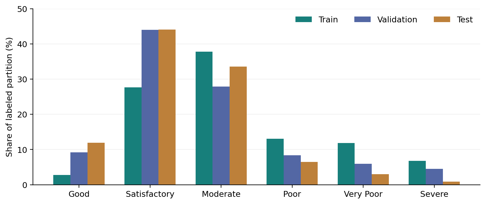

# AirSense actual methodology

## 6. Dataset Description

The selected CSV is the city-level daily table, rather than city_hour.csv, station_day.csv, station_hour.csv or stations.csv from the same supplied archive [3]. Direct inspection finds 29,531 rows, 16 columns and 26 city labels. Of these, 4,681 rows lack AQI_Bucket and are excluded; 24,850 remain. Only 6,236 labeled rows have all 12 pollutant readings, so complete-case deletion would discard much of the usable labeled subset. No City-Date key is duplicated. The observed period ends on 1 July 2020, not at the end of calendar year 2020.

Table 1 and Figure 1 summarize the changing class mixture. The 16 source columns comprise City, Date, 12 pollutant fields, AQI and AQI_Bucket. Derived calendar fields increase the modeling input to 18 predictors; AQI is not used as an input. The experiment uses labels as supplied rather than recomputing official AQI from incomplete pollutant observations. A direct bucket-threshold audit finds zero disagreements between the supplied labeled AQI values and the open-ended intervals at 50, 100, 200, 300 and 400. This consistency check is not independent verification of measurement validity.

The labeled numeric AQI range is 13-2,049. The official report presents categories on a 0-500 scale [2]; values above that scale remain in the supplied data and are retained with their supplied Severe label. The paper does not certify these extreme values as valid official readings. Missing units, aggregation/curation assumptions and extreme values require further data-quality validation.

*Table 1. Class support in each labeled partition and the test class mixture.*

| AQI category | Train | Validation | Test | Test share |
| --- | --- | --- | --- | --- |
| Good | 465 | 347 | 529 | 11.97% |
| Satisfactory | 4,609 | 1,667 | 1,948 | 44.06% |
| Moderate | 6,288 | 1,056 | 1,485 | 33.59% |
| Poor | 2,176 | 318 | 287 | 6.49% |
| Very Poor | 1,979 | 224 | 134 | 3.03% |
| Severe | 1,128 | 172 | 38 | 0.86% |

*Figure 1. Class proportions by chronological partition. The test mixture differs substantially from training; Severe has only 38 test examples.*

Training covers 20 cities, validation 23 and test 26. Six test cities are absent from training: Aizawl, Bhopal, Chandigarh, Ernakulam, Kochi, Shillong. Their 919 test rows represent 20.79% of the test set. Thus the chronological result mixes changing city coverage with temporal change. It is neither a controlled leave-city-out estimate nor an exclusively same-city temporal test. This distinction matters even though City is excluded as a direct predictor.

## 7. Data Preprocessing

The inputs are the 12 pollutant fields PM2.5, PM10, NO, NO2, NOx, NH3, CO, SO2, O3, Benzene, Toluene and Xylene, followed by Year, Month, Day, DayOfWeek, IsWeekend and Season. City and Date are not direct model inputs. Date is used only to create calendar fields and define partitions. Pollutant values remain in source-CSV units; the supplied CSV has no complete machine-readable unit dictionary, and the experiment does not validate or convert source units.

The numeric pipeline computes 1st/99th percentile bounds, clips values, median-imputes missing entries and standardizes. It applies to **all 17 numeric inputs**, including calendar fields, not just pollutant readings. The saved Year clipping interval is 2015-2019; hence test-year 2020 is clipped to the upper training bound before scaling. This is an implementation limitation, not evidence of temporal extrapolation. The categorical branch uses most-frequent imputation and a fixed Season order: Winter, Summer, Monsoon, Post-Monsoon; unknown categories map to -1. Every learned transform is fitted inside each training fold, then the selected pipeline is refitted on the full training partition. The same saved transformation is applied to validation/test observations and application inputs.

*Table 2. Observed predictor missingness before imputation; percentages are computed separately on labeled data and training data.*

| Pollutant | Missing in labeled data | Missing in training |
| --- | --- | --- |
| PM2.5 | 2.73% | 3.36% |
| PM10 | 28.52% | 38.66% |
| NO | 1.56% | 1.45% |
| NO2 | 1.57% | 1.40% |
| NOx | 7.47% | 9.04% |
| NH3 | 26.30% | 33.22% |
| CO | 1.79% | 1.42% |
| SO2 | 2.43% | 2.94% |
| O3 | 3.25% | 3.11% |
| Benzene | 14.23% | 14.05% |
| Toluene | 23.44% | 20.90% |
| Xylene | 61.86% | 62.91% |

Table 2 quantifies missingness before imputation. There are no weather measurements, lead measurements, sensor-quality flags or confirmed causal source labels in the selected feature matrix. A missingness indicator, cyclic calendar encoding and unit harmonization are not part of the fitted pipeline. Their absence is a limitation, not a capability silently supplied by the application.

## 9. Proposed Methodology

*Table 3. Actual labeled partitions, computed from the selected CSV.*

| Partition | Dates | Labeled rows | Cities |
| --- | --- | --- | --- |
| Train | 2015-01-01 to 2019-06-30 | 16,645 | 20 |
| Validation | 2019-07-01 to 2019-12-31 | 3,784 | 23 |
| Test | 2020-01-01 to 2020-07-01 | 4,421 | 26 |

Tables 3 and 4 document the outer partitions and within-training validation windows. Three expanding-date CV windows are constructed from the training partition. The first 40% of distinct observed dates provide the initial warm-up; remaining dates are divided into three validation windows. Fold training dates must be strictly earlier than the validation start minus seven days, leaving a seven-day exclusion interval. Same-day city observations cannot cross a fold boundary. This removes future-to-past fitting within CV, but does not ensure independent observations or remove long-lived city effects.

*Table 4. Full-training-data temporal CV windows used by DT, RF and XGBoost.*

| CV fold | Training rows | Training last date | Validation rows | Validation interval |
| --- | --- | --- | --- | --- |
| 1 | 3,757 | 2016-10-10 | 2,628 | 2016-10-18 to 2017-09-11 |
| 2 | 6,377 | 2017-09-04 | 4,525 | 2017-09-12 to 2018-08-06 |
| 3 | 10,842 | 2018-07-30 | 5,680 | 2018-08-07 to 2019-06-30 |

All four models use six seeded random candidate configurations and three folds, optimizing six-class macro F1; failed fits raise an error. SVM alone uses a stratified 6,000-row training subsample to bound kernel-search cost. Its subset changes the observed date windows: fold training/validation counts are 1465/948, 2417/1628, 4014/1941. SVM and the other finalists are then refitted on all 16,645 training rows. No validation early stopping is used for XGBoost in this run; tree count is searched inside CV.

Candidate choice uses the highest macro F1 on the separate validation partition across four baselines and four tuned finalists; the identifier breaks exact ties. The selected baseline Random Forest is frozen in `models/selection_manifest.json`. Artifact and dataset hashes are checked before the separate final evaluation command. All eight candidates use the same ordered test observations. Test results do not change the frozen choice in the corrected implementation.

The application loads these saved pipelines rather than recreating preprocessing or fitting on refresh. It derives the exact same calendar fields from an entered measurement date, validates the supported pollutant schema, aligns probabilities with fitted class labels and displays unavailable artifacts honestly. These application checks support software correctness; they do not establish scientific validity beyond the experimental design.

## 10. Experimental Setup

The artifact manifests record Python 3.12.14, scikit-learn 1.8.0 and XGBoost 3.4.1, with random_state=42. There are four baselines and four tuned finalists, all fitted on 16,645 training rows. Table 5 lists their principal baseline settings; unspecified settings follow the pinned library defaults stored in the configuration artifacts. DT, RF and SVM use balanced class weights; the multiclass XGBoost model does not use that same class_weight parameter.

*Table 5. Baseline configurations actually used by the corrected experiment.*

| Model | Baseline configuration (other settings use library defaults) |
| --- | --- |
| Decision Tree | Gini; max_depth=10; min_samples_split=20; min_samples_leaf=10; ccp_alpha=0; balanced class weights |
| Random Forest | 200 trees; max_depth=None; min_samples_split=10; min_samples_leaf=5; max_features=sqrt; bootstrap=True; balanced class weights; n_jobs=2 |
| SVM | SVC; RBF; C=10; gamma=scale; balanced class weights; probability=False; default one-vs-one multiclass fitting |
| XGBoost | 300 rounds; max_depth=6; learning_rate=0.05; subsample=0.8; colsample_bytree=0.8; reg_alpha=0.1; reg_lambda=1; multi:softprob; hist; n_jobs=2 |

*Table 6. Finite search spaces and the selected within-search configurations; unchanged parameters inherit the baselines.*

| Model | Search space | Selected parameters |
| --- | --- | --- |
| Decision Tree | depth {5,8,10,15}; leaf {5,10,20}; ccp_alpha {0,0.0005} | depth=10; leaf=5; ccp_alpha=0.0005 |
| Random Forest | trees {100,200}; depth {10,15,None}; leaf {2,5,10}; max_features {sqrt,0.5} | trees=200; depth=None; leaf=10; max_features=0.5 |
| SVM | C {0.1,1,5,10,30}; gamma {scale,auto} | C=5; gamma=auto |
| XGBoost | rounds {150,300}; depth {4,6,8}; learning_rate {0.03,0.05,0.1}; reg_lambda {1,2} | rounds=150; depth=6; learning_rate=0.05; reg_lambda=1 |

Table 6 records both the searched values and the chosen configuration. Six configurations sampled with seed 42 produce 18 CV fits per model, followed by one full-training refit of the chosen search configuration. CV estimator parallelism is reduced to one thread for RF/XGBoost during the two-job outer search. Final full fits use the saved two-job estimator setting. There is no GPU requirement or new model training for paper generation.

Metrics are generated from actual predictions using the fixed six-label universe and zero_division=0. The outputs include accuracy, macro precision, macro recall, macro F1, weighted F1, per-class scores/support and raw confusion matrices. Inference timing includes the whole preprocessing/classifier pipeline: the median of three full-test prediction calls after a small warm-up. Per-row times are batch averages, not interactive latency guarantees. Search cost is recorded separately from full-data refit cost.

The uploaded project and an earlier audit had already examined test outcomes. The corrected code separates tuning/selection from final evaluation, but this cannot erase historical knowledge. The results are explicitly retrospective. A new external dataset is needed for an independent confirmatory claim. No training or tuning is performed to write this paper.

Complete CV tables, final model/configuration files, test_predictions.csv, per_class_comparison.csv and evaluation_results.json are included in the project. This paper's generation script independently recomputes aggregate scores and all confusion matrices from the saved predictions and checks the model hashes before writing the paper. The dataset SHA-256 is 0d84b21c3e4878bbad8df362f2ab05f61ad959538dddf5918e714077ed3c1847.
