# AirSense — Unified model comparison

The uploaded project and the earlier audit had already inspected test outcomes. This corrected rerun is a retrospective benchmark, not a pristine prospective holdout. No test scores are used by the corrected selection/tuning code. New external data is required for an independent final claim.

## Experimental protocol

Chronological shared partitions: train through 2019-06-30; validation July–December 2019; final retrospective test January–July 2020 (4,421 labeled city-days). All successful models receive the exact same ordered test rows. AQI and its bucket are excluded from predictors; the task is same-day category estimation from contemporaneous pollutants, not future forecasting. City identity is excluded. No weather fields are available.

**Selected candidate: random_forest**. Highest validation macro F1 across baseline and tuned candidates; identifier breaks ties. The selection manifest and model hashes were checked before test evaluation; test scores are descriptive and do not change this choice.

## Baseline models — actual test predictions

| model | accuracy | macro_precision | macro_recall | macro_f1 | weighted_f1 | train_time_sec | inference_time_sec |
| --- | --- | --- | --- | --- | --- | --- | --- |
| Random Forest | 0.807736 | 0.794249 | 0.774264 | 0.782597 | 0.807005 | 4.789157 | 0.142192 |
| XGBoost | 0.809545 | 0.821805 | 0.734794 | 0.769019 | 0.805691 | 5.601448 | 0.213471 |
| SVM | 0.747342 | 0.722591 | 0.723169 | 0.721180 | 0.748365 | 6.102714 | 4.097413 |
| Decision Tree | 0.735128 | 0.698046 | 0.758338 | 0.716209 | 0.739400 | 0.231709 | 0.008027 |

## Baseline and tuned candidates — actual test predictions

| model | accuracy | macro_precision | macro_recall | macro_f1 | weighted_f1 | train_time_sec | inference_time_sec |
| --- | --- | --- | --- | --- | --- | --- | --- |
| random_forest | 0.807736 | 0.794249 | 0.774264 | 0.782597 | 0.807005 | 4.789157 | 0.142192 |
| tuned_random_forest | 0.798010 | 0.772718 | 0.776671 | 0.772385 | 0.798582 | 13.845522 | 0.261920 |
| xgboost | 0.809545 | 0.821805 | 0.734794 | 0.769019 | 0.805691 | 5.601448 | 0.213471 |
| tuned_xgboost | 0.809998 | 0.818312 | 0.730079 | 0.764014 | 0.805353 | 4.044617 | 0.123860 |
| tuned_svm | 0.750509 | 0.723973 | 0.731987 | 0.726096 | 0.751894 | 7.094371 | 3.356822 |
| svm | 0.747342 | 0.722591 | 0.723169 | 0.721180 | 0.748365 | 6.102714 | 4.097413 |
| tuned_decision_tree | 0.734902 | 0.693996 | 0.763463 | 0.718350 | 0.739432 | 0.456307 | 0.009431 |
| decision_tree | 0.735128 | 0.698046 | 0.758338 | 0.716209 | 0.739400 | 0.231709 | 0.008027 |

Training time includes fitting the full preprocessing/classifier pipeline. For tuned models it is the full-data refit time; search costs are separately recorded in the tuning report. Inference time is the median of three complete pipeline prediction calls after one small warm-up, on identical test rows, including preprocessing for every model. Hardware-dependent timings are not portable benchmarks.

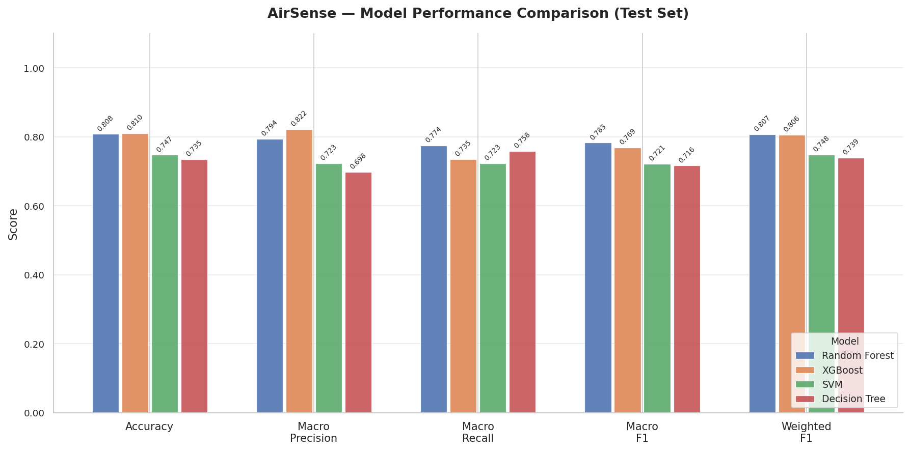

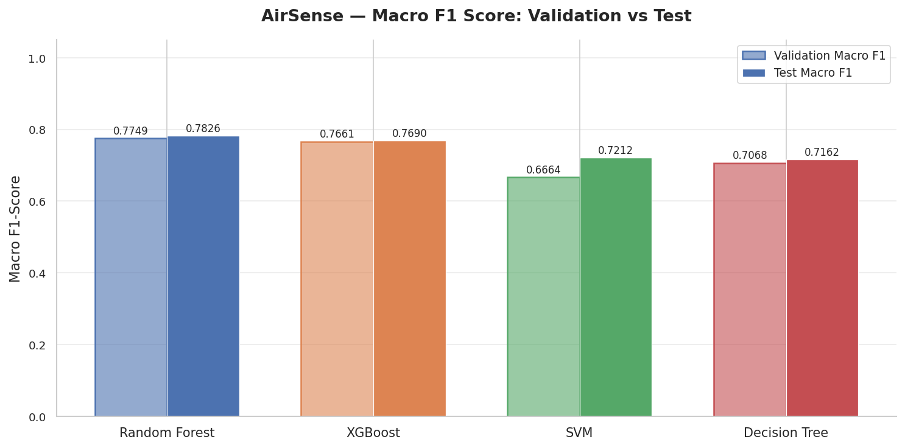

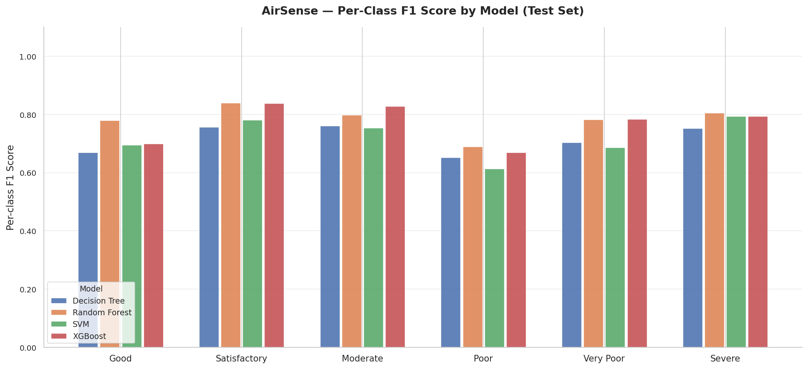

## Per-class precision, recall and F1

| candidate | class | precision | recall | f1-score | support |
| --- | --- | --- | --- | --- | --- |
| decision_tree | Good | 0.540698 | 0.879017 | 0.669546 | 529.000000 |
| decision_tree | Satisfactory | 0.805090 | 0.714579 | 0.757139 | 1948.000000 |
| decision_tree | Moderate | 0.815729 | 0.712458 | 0.760604 | 1485.000000 |
| decision_tree | Poor | 0.576000 | 0.752613 | 0.652568 | 287.000000 |
| decision_tree | Very Poor | 0.769912 | 0.649254 | 0.704453 | 134.000000 |
| decision_tree | Severe | 0.680851 | 0.842105 | 0.752941 | 38.000000 |
| random_forest | Good | 0.826638 | 0.739130 | 0.780439 | 529.000000 |
| random_forest | Satisfactory | 0.803279 | 0.880390 | 0.840069 | 1948.000000 |
| random_forest | Moderate | 0.843328 | 0.757576 | 0.798155 | 1485.000000 |
| random_forest | Poor | 0.665584 | 0.714286 | 0.689076 | 287.000000 |
| random_forest | Very Poor | 0.773723 | 0.791045 | 0.782288 | 134.000000 |
| random_forest | Severe | 0.852941 | 0.763158 | 0.805556 | 38.000000 |
| svm | Good | 0.647635 | 0.750473 | 0.695271 | 529.000000 |
| svm | Satisfactory | 0.775417 | 0.786961 | 0.781146 | 1948.000000 |
| svm | Moderate | 0.793462 | 0.719192 | 0.754504 | 1485.000000 |
| svm | Poor | 0.578462 | 0.655052 | 0.614379 | 287.000000 |
| svm | Very Poor | 0.712000 | 0.664179 | 0.687259 | 134.000000 |
| svm | Severe | 0.828571 | 0.763158 | 0.794521 | 38.000000 |
| xgboost | Good | 0.904192 | 0.570888 | 0.699884 | 529.000000 |
| xgboost | Satisfactory | 0.809251 | 0.871150 | 0.839061 | 1948.000000 |
| xgboost | Moderate | 0.802399 | 0.855892 | 0.828283 | 1485.000000 |
| xgboost | Poor | 0.731405 | 0.616725 | 0.669187 | 287.000000 |
| xgboost | Very Poor | 0.783582 | 0.783582 | 0.783582 | 134.000000 |
| xgboost | Severe | 0.900000 | 0.710526 | 0.794118 | 38.000000 |
| tuned_decision_tree | Good | 0.519685 | 0.873346 | 0.651622 | 529.000000 |
| tuned_decision_tree | Satisfactory | 0.799769 | 0.711499 | 0.753056 | 1948.000000 |
| tuned_decision_tree | Moderate | 0.827613 | 0.730640 | 0.776109 | 1485.000000 |
| tuned_decision_tree | Poor | 0.625000 | 0.609756 | 0.617284 | 287.000000 |
| tuned_decision_tree | Very Poor | 0.664634 | 0.813433 | 0.731544 | 134.000000 |
| tuned_decision_tree | Severe | 0.727273 | 0.842105 | 0.780488 | 38.000000 |
| tuned_random_forest | Good | 0.700159 | 0.829868 | 0.759516 | 529.000000 |
| tuned_random_forest | Satisfactory | 0.807597 | 0.840349 | 0.823648 | 1948.000000 |
| tuned_random_forest | Moderate | 0.862928 | 0.746128 | 0.800289 | 1485.000000 |
| tuned_random_forest | Poor | 0.668750 | 0.745645 | 0.705107 | 287.000000 |
| tuned_random_forest | Very Poor | 0.796875 | 0.761194 | 0.778626 | 134.000000 |
| tuned_random_forest | Severe | 0.800000 | 0.736842 | 0.767123 | 38.000000 |
| tuned_svm | Good | 0.634069 | 0.759924 | 0.691316 | 529.000000 |
| tuned_svm | Satisfactory | 0.780500 | 0.784908 | 0.782698 | 1948.000000 |
| tuned_svm | Moderate | 0.803438 | 0.723906 | 0.761601 | 1485.000000 |
| tuned_svm | Poor | 0.585139 | 0.658537 | 0.619672 | 287.000000 |
| tuned_svm | Very Poor | 0.712121 | 0.701493 | 0.706767 | 134.000000 |
| tuned_svm | Severe | 0.828571 | 0.763158 | 0.794521 | 38.000000 |
| tuned_xgboost | Good | 0.911392 | 0.544423 | 0.681657 | 529.000000 |
| tuned_xgboost | Satisfactory | 0.801300 | 0.886037 | 0.841541 | 1948.000000 |
| tuned_xgboost | Moderate | 0.815295 | 0.847138 | 0.830911 | 1485.000000 |
| tuned_xgboost | Poor | 0.730612 | 0.623693 | 0.672932 | 287.000000 |
| tuned_xgboost | Very Poor | 0.780303 | 0.768657 | 0.774436 | 134.000000 |
| tuned_xgboost | Severe | 0.870968 | 0.710526 | 0.782609 | 38.000000 |

## Accuracy versus macro F1

Accuracy ranking: XGBoost, Random Forest, SVM, Decision Tree. Macro F1 ranking: Random Forest, XGBoost, SVM, Decision Tree. The rankings differ. Agreement alone does not establish good minority-class performance; inspect per-class recall. Macro F1 assigns equal weight to each of the six CPCB classes.

Lowest mean class F1 across successful candidates: **Poor** (0.6550); highest: **Satisfactory** (0.8023).

Highest observed test macro F1: **random_forest** (0.7826). This retrospective ranking is distinct from the validation-selected deployment candidate.

## Confusion matrices and measured errors

Rows are true labels and columns predictions; category order runs Good to Severe. Above-diagonal predictions overestimate severity; below-diagonal predictions underestimate it. No claim about errors near regulatory breakpoints is made without a separate distance-to-boundary analysis.

### decision_tree

Errors: 1171; adjacent-category errors: 1130 (96.5% of errors).

Largest off-diagonal count: Satisfactory → Good: 363. Underestimates: 753; overestimates: 418.

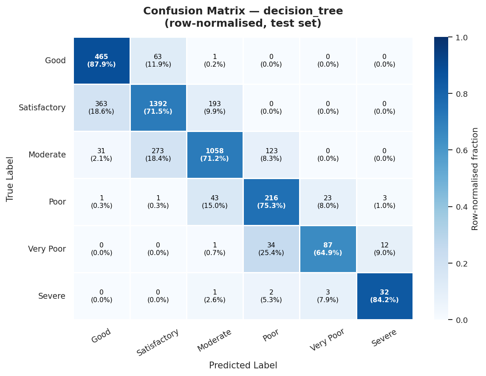

### random_forest

Errors: 850; adjacent-category errors: 842 (99.1% of errors).

Largest off-diagonal count: Moderate → Satisfactory: 282. Underestimates: 453; overestimates: 397.

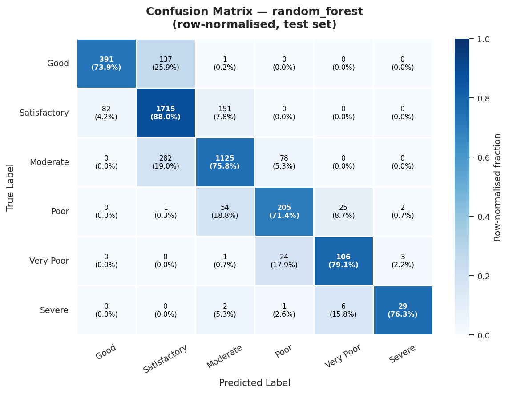

### svm

Errors: 1117; adjacent-category errors: 1097 (98.2% of errors).

Largest off-diagonal count: Moderate → Satisfactory: 315. Underestimates: 649; overestimates: 468.

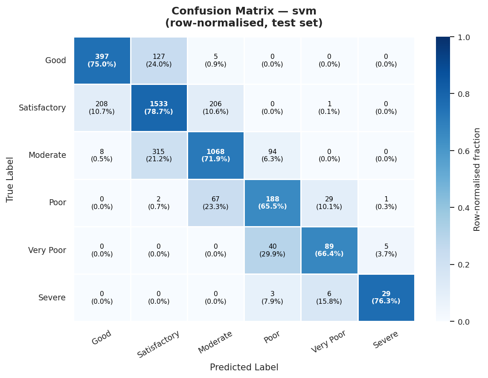

### xgboost

Errors: 842; adjacent-category errors: 833 (98.9% of errors).

Largest off-diagonal count: Good → Satisfactory: 225. Underestimates: 333; overestimates: 509.

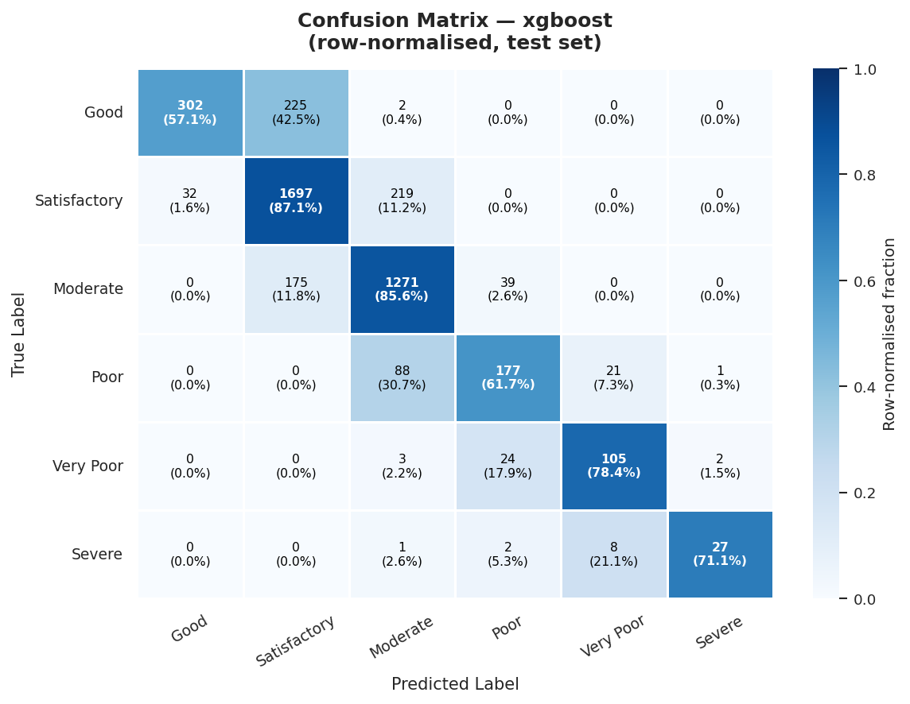

### tuned_decision_tree

Errors: 1172; adjacent-category errors: 1126 (96.1% of errors).

Largest off-diagonal count: Satisfactory → Good: 396. Underestimates: 787; overestimates: 385.

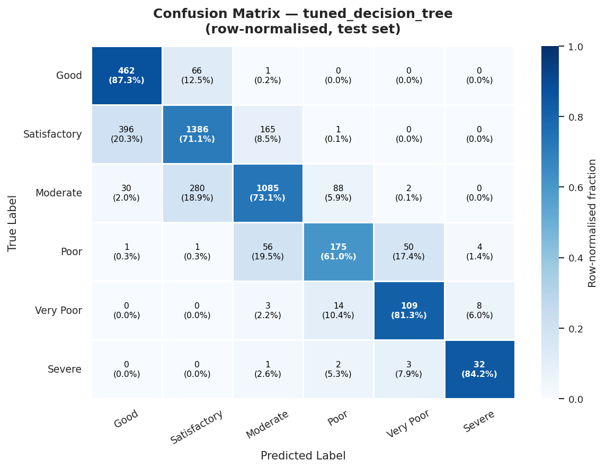

### tuned_random_forest

Errors: 893; adjacent-category errors: 884 (99.0% of errors).

Largest off-diagonal count: Moderate → Satisfactory: 300. Underestimates: 578; overestimates: 315.

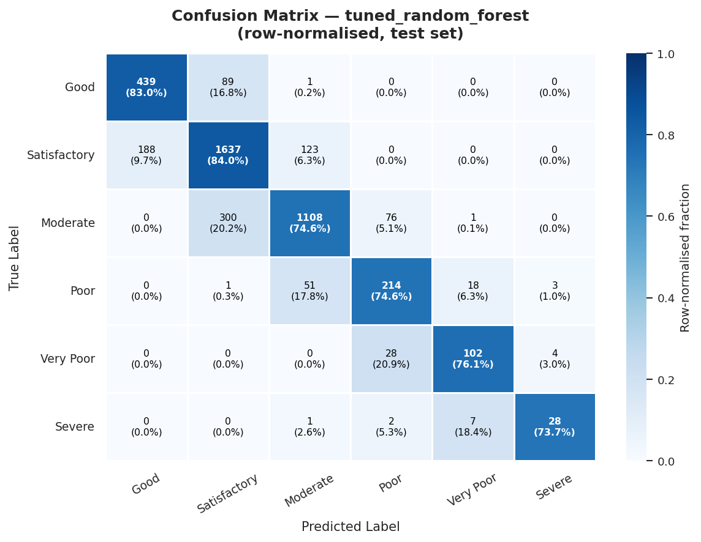

### tuned_svm

Errors: 1103; adjacent-category errors: 1082 (98.1% of errors).

Largest off-diagonal count: Moderate → Satisfactory: 305. Underestimates: 648; overestimates: 455.

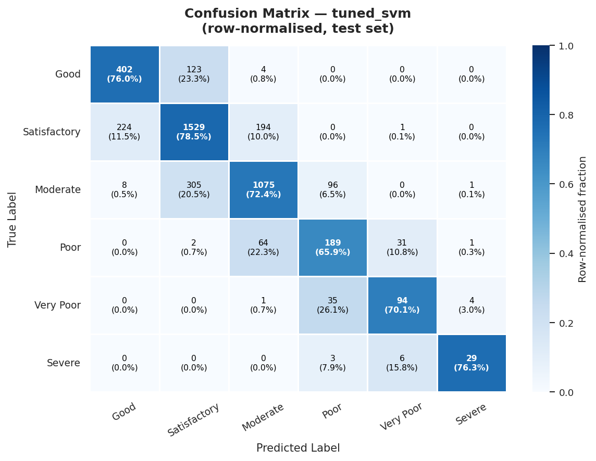

### tuned_xgboost

Errors: 840; adjacent-category errors: 830 (98.8% of errors).

Largest off-diagonal count: Good → Satisfactory: 239. Underestimates: 342; overestimates: 498.

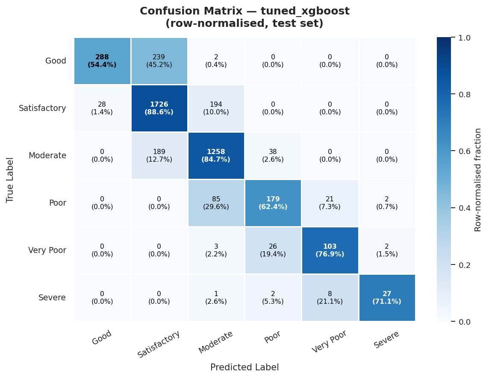

## Limitations

One dataset, one seed and fixed chronological periods; no confidence intervals or statistical significance claims. The 2020 test period includes unusual pandemic conditions and seasonal/class distribution shift. Adjacent city-days remain dependent even with date-blocked CV. City-disjoint transfer has not been tested. Same-day pollutant inputs are related to the AQI definition, so high accuracy does not establish forecasting ability. Missingness, imputation, winsorisation and exclusion of unlabeled days may bias results. Weather and lead measurements are unavailable. Historical test exposure prevents an independent confirmatory claim.

## Comparison with primary survey

Méndez, Merayo & Núñez (2023), Machine learning algorithms to forecast air quality: a survey. https://doi.org/10.1007/s10462-023-10424-4 (publisher verified 2026-11-01). Section 3.3 discusses predictor groups, including pollutant and weather variables. Section 3.4 distinguishes metric types and reports widespread use of RMSE/MSE and MAE as well as ACC, R² and MAPE. AirSense instead evaluates six-class, same-day AQI classification using macro F1 and per-class errors. Chronological splitting and macro-F1 selection here are our experimental choices, not attributed recommendations from the survey. Datasets, targets, horizons, splits and metrics differ, so our scores are not directly comparable with published scores. No universal ensemble advantage or macro-F1 recommendation is attributed to this survey.

## Reproduce

`python -m scripts.train_all_models` → `python -m scripts.tune_models` → `python -m scripts.evaluate_all_models` → `python -m scripts.analyze_features`. Machine-readable predictions, confusion matrices, failures and manifests are saved alongside this report.