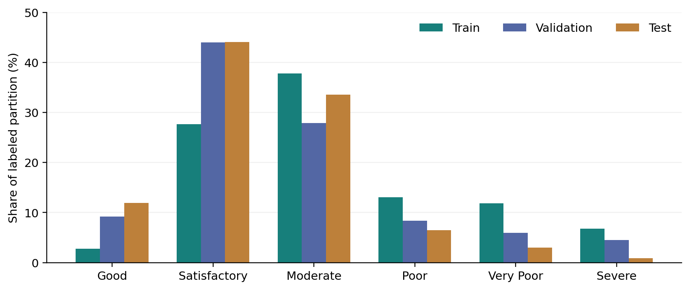
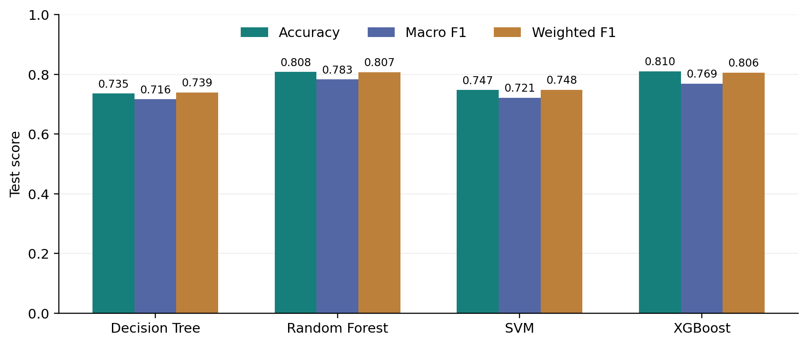
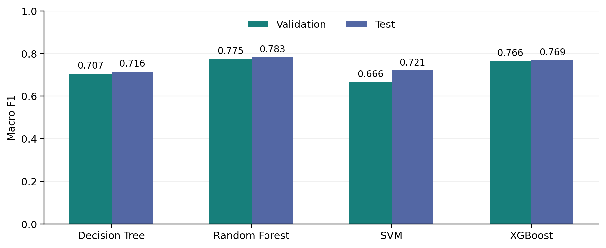
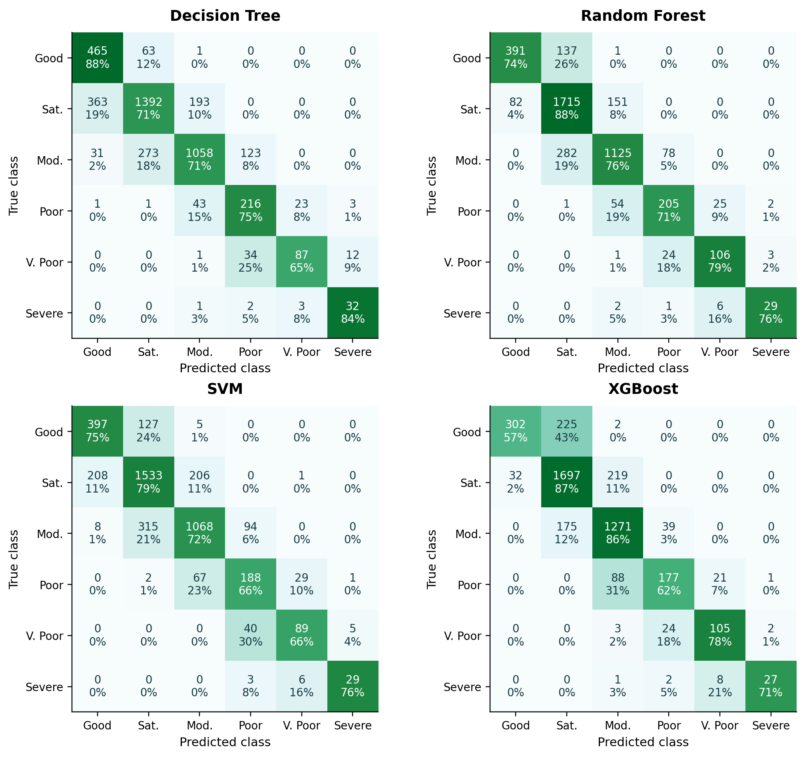
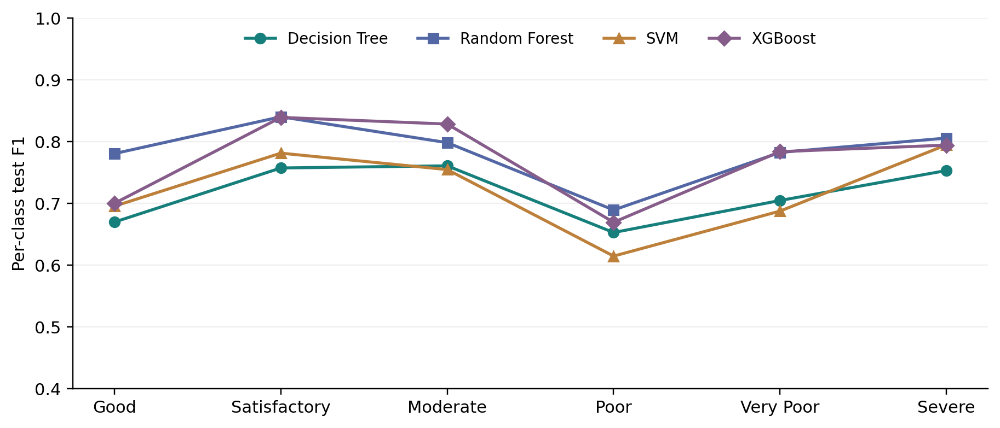
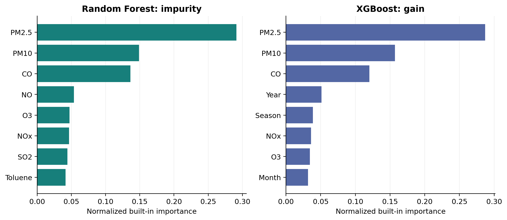
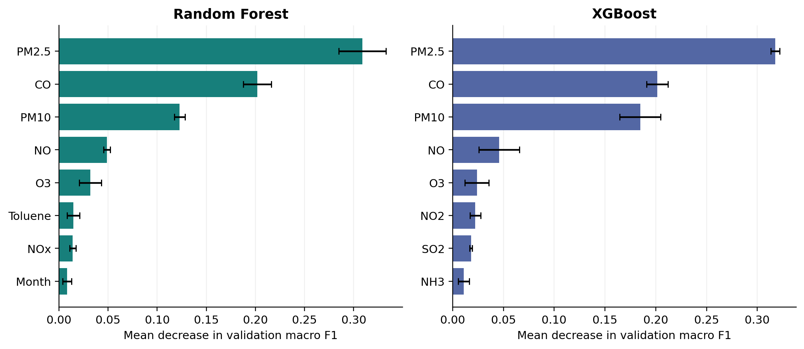
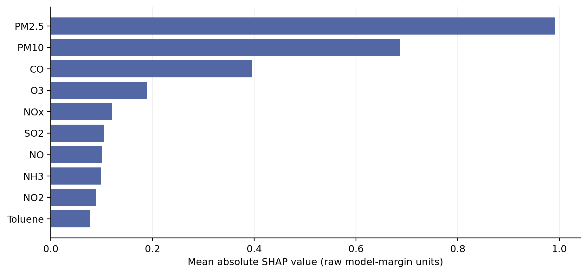

# AirSense: A Retrospective Benchmark for Same-Day Air Quality Category Classification

**Research-style project paper | 1 November 2026 | Prompts 11-14 evidence**

**Status:** Technical research draft. PDF generation and software verification do not establish publication readiness, scientific novelty or deployment validity. Authorship and affiliation were not supplied for this paper and have not been invented.

## Abstract

AirSense compares Decision Tree, Random Forest, radial-basis SVM and XGBoost for same-day, six-category AQI classification using the supplied Indian city-day dataset. The selected CSV contains 29,531 records dated 2015-01-01 through 2020-07-01, of which 24,850 have labels. Chronological partitions contain 16,645 training, 3,784 validation and 4,421 test observations. Training-only temporal cross-validation uses fold-local preprocessing and a bounded six-candidate search per model; all finalists are refitted on the full training partition. Selection is frozen using validation macro F1. The selected baseline Random Forest achieves test accuracy 0.8077 and macro F1 0.7826. Baseline XGBoost achieves higher accuracy, 0.8095, but lower macro F1, 0.7690, illustrating a class-balance trade-off. Poor is the most difficult class by mean baseline F1; 842 of RF's 850 errors are between adjacent categories. Permutation and SHAP analyses consistently emphasize particulate measurements and CO, without implying causality. The test partition mixes time shift with expanding city coverage, and calendar numerics are clipped by the saved preprocessing. Historical test exposure, missing weather fields, limited rare-class support and absence of independent prospective validation constrain the conclusions. These are retrospective classification results, not evidence of future forecasting capability.

## Keywords

Air quality; AQI classification; Random Forest; SVM; XGBoost; macro F1; temporal validation; feature importance; reproducibility.

## 1. Introduction

Air-quality measurement produces a multivariate record rather than a single directly interpretable category. A classifier can learn associations between the recorded pollutant mixture, calendar context and an existing AQI label. The engineering challenge is not merely to display a high score: incomplete observations, unequal class frequencies and shifting monitoring coverage complicate both model selection and interpretation.

AirSense is a research-style project benchmark and demonstration application. It uses existing daily Indian city records to compare four established classifiers under a common chronological protocol. The output is an estimated category for an observed day. It is not a forecast of a future day, and the model is not a replacement for the official index procedure or validated sensor measurements [2].

The work contributes an auditable implementation rather than a new learning algorithm. Its saved predictions, model configurations, cross-validation records and feature-importance files support reproducibility at the project level. Every empirical table and figure below is derived from those artifacts or from direct inspection of the selected CSV. The main methodological priority is a clear boundary between what was observed, what was selected using validation, and what remains untested.

## 2. Problem Statement

Given contemporaneous pollutant readings and the date for a city-day, estimate its supplied AQI_Bucket label among six ordered categories. Formally, the task is to learn a mapping from the available 18-dimensional input to one of six class identifiers. The date supplies calendar context, not a forecast horizon. No sensor sequence, future weather input or future-label target is constructed.

The comparison must use identical test identities and a preprocessing pipeline whose parameters are learned only from appropriate training observations. Model selection must prioritize a metric that does not allow frequent classes to dominate by construction. The final interface must retain the exact fitted preprocessing and distinguish unsupported probabilities or missing artifacts from successful model outputs.

## 3. Research Objectives

- Compare four established classifiers with a shared, documented chronological split.
- Evaluate overall and per-class behavior using actual predictions, including macro and weighted metrics.
- Perform a controlled, computationally bounded training-only search and compare finalists with baselines on validation.
- Inspect RF/XGBoost feature associations using built-in importance, validation permutation and feasible SHAP analysis.
- Preserve traceable experimental outputs and expose them in a read-only Streamlit demonstration.
- Document uncertainty, historical test exposure, target-construction effects and untested generalization instead of claiming unrestricted performance.

## 4. Literature Review

Méndez, Merayo and Núñez [1] review 155 studies covering 2011-2021. They organize the literature by geography, predicted quantities, predictors, evaluation metrics and model families. Section 3.3 distinguishes pollutant, meteorological and other predictors; Section 3.4 separates metric types and discusses accuracy and regression errors. Their Section 4 covers individual, hybrid and comparative approaches. This is a survey of heterogeneous forecasting studies, not a benchmark result on the AirSense dataset.

For AirSense, this taxonomy becomes a reporting checklist: identify the target and time horizon, list only available inputs, document the split, and choose metrics suited to the task. Pollutant measurements are available; weather measurements are not. Calendar fields can encode seasonal structure, but cannot establish meteorological effects. The present four-classifier comparison is an implementation choice for tabular data, not evidence that these methods exhaust the literature or universally outperform alternatives.

A useful comparison therefore concerns experimental questions rather than published score magnitudes. AirSense estimates a category from contemporaneous measurements; future forecasting would require a declared lead time and inputs available before the target day. Classification F1 cannot be interpreted as concentration-regression error. The split dates, city coverage and target construction must also agree before numerical comparisons become meaningful. We do not identify an unverified literature-wide gap or claim a new learning algorithm.

The foundational works on Random Forests [5], support-vector networks [6], gradient boosting systems [7] and additive feature attribution [8] explain the model/interpretation families used here. These references support theoretical mechanisms, not claims about their performance on this CSV. The contribution is a reproducible, bounded project experiment with explicit provenance and a read-only demonstration interface.

## 5. Research Motivation

The project asks whether an equal-class selection criterion leads to the same practical choice as accuracy, whether tuning helps within a modest budget, and whether different attribution methods agree on influential predictors. These are questions about this implementation and dataset, not claimed omissions across the research field.

A shared evaluation framework also addresses an engineering risk: otherwise, apparently comparable models may be assessed on different rows, use different transformations, or expose fabricated/static metrics in a demonstration. AirSense therefore couples its software with explicit saved predictions and provenance checks. The scientific motivation is disciplined reporting and interpretable error analysis, with no claim that the tabular classifier solves the harder forecasting problem.

## 6. Dataset Description

The selected CSV is the city-level daily table, rather than city_hour.csv, station_day.csv, station_hour.csv or stations.csv from the same supplied archive [3]. Direct inspection finds 29,531 rows, 16 columns and 26 city labels. Of these, 4,681 rows lack AQI_Bucket and are excluded; 24,850 remain. Only 6,236 labeled rows have all 12 pollutant readings, so complete-case deletion would discard much of the usable labeled subset. No City-Date key is duplicated. The observed period ends on 1 July 2020, not at the end of calendar year 2020.

Table 1 and Figure 1 summarize the changing class mixture. The 16 source columns comprise City, Date, 12 pollutant fields, AQI and AQI_Bucket. Derived calendar fields increase the modeling input to 18 predictors; AQI is not used as an input. The experiment uses labels as supplied rather than recomputing official AQI from incomplete pollutant observations. A direct bucket-threshold audit finds zero disagreements between the supplied labeled AQI values and the open-ended intervals at 50, 100, 200, 300 and 400. This consistency check is not independent verification of measurement validity.

The labeled numeric AQI range is 13-2,049. The official report presents categories on a 0-500 scale [2]; values above that scale remain in the supplied data and are retained with their supplied Severe label. The paper does not certify these extreme values as valid official readings. Missing units, aggregation/curation assumptions and extreme values require further data-quality validation.

*Table 1. Class support in each labeled partition and the test class mixture.*

| AQI category | Train | Validation | Test | Test share |
| --- | --- | --- | --- | --- |
| Good | 465 | 347 | 529 | 11.97% |
| Satisfactory | 4,609 | 1,667 | 1,948 | 44.06% |
| Moderate | 6,288 | 1,056 | 1,485 | 33.59% |
| Poor | 2,176 | 318 | 287 | 6.49% |
| Very Poor | 1,979 | 224 | 134 | 3.03% |
| Severe | 1,128 | 172 | 38 | 0.86% |

*Figure 1. Class proportions by chronological partition. The test mixture differs substantially from training; Severe has only 38 test examples.*

Training covers 20 cities, validation 23 and test 26. Six test cities are absent from training: Aizawl, Bhopal, Chandigarh, Ernakulam, Kochi, Shillong. Their 919 test rows represent 20.79% of the test set. Thus the chronological result mixes changing city coverage with temporal change. It is neither a controlled leave-city-out estimate nor an exclusively same-city temporal test. This distinction matters even though City is excluded as a direct predictor.

## 7. Data Preprocessing

The inputs are the 12 pollutant fields PM2.5, PM10, NO, NO2, NOx, NH3, CO, SO2, O3, Benzene, Toluene and Xylene, followed by Year, Month, Day, DayOfWeek, IsWeekend and Season. City and Date are not direct model inputs. Date is used only to create calendar fields and define partitions. Pollutant values remain in source-CSV units; the supplied CSV has no complete machine-readable unit dictionary, and the experiment does not validate or convert source units.

The numeric pipeline computes 1st/99th percentile bounds, clips values, median-imputes missing entries and standardizes. It applies to **all 17 numeric inputs**, including calendar fields, not just pollutant readings. The saved Year clipping interval is 2015-2019; hence test-year 2020 is clipped to the upper training bound before scaling. This is an implementation limitation, not evidence of temporal extrapolation. The categorical branch uses most-frequent imputation and a fixed Season order: Winter, Summer, Monsoon, Post-Monsoon; unknown categories map to -1. Every learned transform is fitted inside each training fold, then the selected pipeline is refitted on the full training partition. The same saved transformation is applied to validation/test observations and application inputs.

*Table 2. Observed predictor missingness before imputation; percentages are computed separately on labeled data and training data.*

| Pollutant | Missing in labeled data | Missing in training |
| --- | --- | --- |
| PM2.5 | 2.73% | 3.36% |
| PM10 | 28.52% | 38.66% |
| NO | 1.56% | 1.45% |
| NO2 | 1.57% | 1.40% |
| NOx | 7.47% | 9.04% |
| NH3 | 26.30% | 33.22% |
| CO | 1.79% | 1.42% |
| SO2 | 2.43% | 2.94% |
| O3 | 3.25% | 3.11% |
| Benzene | 14.23% | 14.05% |
| Toluene | 23.44% | 20.90% |
| Xylene | 61.86% | 62.91% |

Table 2 quantifies missingness before imputation. There are no weather measurements, lead measurements, sensor-quality flags or confirmed causal source labels in the selected feature matrix. A missingness indicator, cyclic calendar encoding and unit harmonization are not part of the fitted pipeline. Their absence is a limitation, not a capability silently supplied by the application.

## 8. Theoretical Background

### 8.1 Air quality and the AQI target

Air quality describes the ambient pollutant mixture. India's AQI communicates that mixture through pollutant-specific sub-indices and an overall category [2]. Good, Satisfactory, Moderate, Poor, Very Poor and Severe are ordinal labels, but the present classifiers optimize nominal multiclass objectives rather than ordinal error costs. A one-category and a several-category error are equally wrong in accuracy, which makes the confusion matrix necessary for interpretation. Predicting the existing label from contemporaneous pollutants partly learns the target's construction; this is not, by itself, forbidden target leakage, but substantially narrows the task.

### 8.2 Decision Tree and Random Forest

A classification tree recursively chooses feature thresholds to reduce class impurity [4]. For class fractions p_k in a node, Gini impurity is G = 1 - sum_k(p_k squared); an effective split reduces the weighted impurities of the child nodes. Depth, minimum leaf size and pruning constrain complexity. A tree is interpretable as a sequence of conditions, but small data changes can alter its partition.

Random Forest combines many randomized trees [5]. Bootstrap sampling changes each tree's observations, and random feature subsets diversify splits. The scikit-learn classifier averages the trees' class-probability estimates before taking the highest-scoring class. Averaging can reduce variance, but correlated trees, biased coverage and unrepresentative data remain problems. More trees do not automatically resolve distribution shift.

### 8.3 Support Vector Machine

A soft-margin binary SVM balances margin size against classification violations [6]. A standard objective is (1/2)||w|| squared + C sum_i(xi_i), subject to y_i(w dot phi(x_i) + b) >= 1 - xi_i and xi_i >= 0. AirSense uses the RBF kernel K(x,z)=exp(-gamma ||x-z|| squared) and the library's one-versus-one multiclass fitting. Scaling affects distances; C and gamma govern flexibility. The saved SVM provides a class prediction but not calibrated probabilities because probability estimation was disabled.

### 8.4 XGBoost

Gradient boosting adds trees sequentially to improve a regularized objective [7]. In simplified notation, the objective sums multiclass prediction losses and tree penalties; a common tree penalty is gamma*T + (lambda/2) sum_j(w_j squared), with additional L1 regularization when used. Learning rate, tree depth, row/column subsampling and regularization constrain the fitted ensemble. The present multiclass soft-probability model uses histogram tree construction and fixed candidate tree counts, not test-driven early stopping.

### 8.5 Classification metrics

For a class k treated one-versus-rest: Precision_k = TP_k/(TP_k+FP_k), Recall_k = TP_k/(TP_k+FN_k), and F1_k = 2*Precision_k*Recall_k/(Precision_k+Recall_k). Undefined divisions are assigned zero in this implementation [4]. Accuracy is the number of correct labels divided by sample count. Macro precision, recall and F1 are arithmetic means over the fixed six categories. Macro F1 is the mean of the class F1 values, not necessarily the harmonic mean of macro precision and macro recall. Weighted F1 weights each class F1 by its true support. Confusion-matrix cell C_ij counts true class i predicted as j.

Macro averaging gives a rare category the same contribution as a frequent one, but can have high variance when support is small. Weighted F1 and accuracy describe different summaries and may mask weak rare-class recall. None of these point metrics establishes calibration, uncertainty or causal validity.

### 8.6 Feature-importance methods

RF impurity importance accumulates split-impurity reductions and can favor features with many candidate splits. XGBoost gain reflects split improvements under its own objective. Permutation importance measures score degradation after shuffling one predictor on held-out data [4]; correlated substitutes and unrealistic shuffled combinations can affect it. SHAP assigns additive attributions to a model output relative to a reference distribution [8]. Aggregated absolute attributions show magnitude rather than direction. All are predictive descriptions of a fitted model, not estimates of causal intervention effects.

## 9. Proposed Methodology

*Table 3. Actual labeled partitions, computed from the selected CSV.*

| Partition | Dates | Labeled rows | Cities |
| --- | --- | --- | --- |
| Train | 2015-01-01 to 2019-06-30 | 16,645 | 20 |
| Validation | 2019-07-01 to 2019-12-31 | 3,784 | 23 |
| Test | 2020-01-01 to 2020-07-01 | 4,421 | 26 |

Tables 3 and 4 document the outer partitions and within-training validation windows. Three expanding-date CV windows are constructed from the training partition. The first 40% of distinct observed dates provide the initial warm-up; remaining dates are divided into three validation windows. Fold training dates must be strictly earlier than the validation start minus seven days, leaving a seven-day exclusion interval. Same-day city observations cannot cross a fold boundary. This removes future-to-past fitting within CV, but does not ensure independent observations or remove long-lived city effects.

*Table 4. Full-training-data temporal CV windows used by DT, RF and XGBoost.*

| CV fold | Training rows | Training last date | Validation rows | Validation interval |
| --- | --- | --- | --- | --- |
| 1 | 3,757 | 2016-10-10 | 2,628 | 2016-10-18 to 2017-09-11 |
| 2 | 6,377 | 2017-09-04 | 4,525 | 2017-09-12 to 2018-08-06 |
| 3 | 10,842 | 2018-07-30 | 5,680 | 2018-08-07 to 2019-06-30 |

All four models use six seeded random candidate configurations and three folds, optimizing six-class macro F1; failed fits raise an error. SVM alone uses a stratified 6,000-row training subsample to bound kernel-search cost. Its subset changes the observed date windows: fold training/validation counts are 1465/948, 2417/1628, 4014/1941. SVM and the other finalists are then refitted on all 16,645 training rows. No validation early stopping is used for XGBoost in this run; tree count is searched inside CV.

Candidate choice uses the highest macro F1 on the separate validation partition across four baselines and four tuned finalists; the identifier breaks exact ties. The selected baseline Random Forest is frozen in `models/selection_manifest.json`. Artifact and dataset hashes are checked before the separate final evaluation command. All eight candidates use the same ordered test observations. Test results do not change the frozen choice in the corrected implementation.

The application loads these saved pipelines rather than recreating preprocessing or fitting on refresh. It derives the exact same calendar fields from an entered measurement date, validates the supported pollutant schema, aligns probabilities with fitted class labels and displays unavailable artifacts honestly. These application checks support software correctness; they do not establish scientific validity beyond the experimental design.

## 10. Experimental Setup

The artifact manifests record Python 3.12.14, scikit-learn 1.8.0 and XGBoost 3.4.1, with random_state=42. There are four baselines and four tuned finalists, all fitted on 16,645 training rows. Table 5 lists their principal baseline settings; unspecified settings follow the pinned library defaults stored in the configuration artifacts. DT, RF and SVM use balanced class weights; the multiclass XGBoost model does not use that same class_weight parameter.

*Table 5. Baseline configurations actually used by the corrected experiment.*

| Model | Baseline configuration (other settings use library defaults) |
| --- | --- |
| Decision Tree | Gini; max_depth=10; min_samples_split=20; min_samples_leaf=10; ccp_alpha=0; balanced class weights |
| Random Forest | 200 trees; max_depth=None; min_samples_split=10; min_samples_leaf=5; max_features=sqrt; bootstrap=True; balanced class weights; n_jobs=2 |
| SVM | SVC; RBF; C=10; gamma=scale; balanced class weights; probability=False; default one-vs-one multiclass fitting |
| XGBoost | 300 rounds; max_depth=6; learning_rate=0.05; subsample=0.8; colsample_bytree=0.8; reg_alpha=0.1; reg_lambda=1; multi:softprob; hist; n_jobs=2 |

*Table 6. Finite search spaces and the selected within-search configurations; unchanged parameters inherit the baselines.*

| Model | Search space | Selected parameters |
| --- | --- | --- |
| Decision Tree | depth {5,8,10,15}; leaf {5,10,20}; ccp_alpha {0,0.0005} | depth=10; leaf=5; ccp_alpha=0.0005 |
| Random Forest | trees {100,200}; depth {10,15,None}; leaf {2,5,10}; max_features {sqrt,0.5} | trees=200; depth=None; leaf=10; max_features=0.5 |
| SVM | C {0.1,1,5,10,30}; gamma {scale,auto} | C=5; gamma=auto |
| XGBoost | rounds {150,300}; depth {4,6,8}; learning_rate {0.03,0.05,0.1}; reg_lambda {1,2} | rounds=150; depth=6; learning_rate=0.05; reg_lambda=1 |

Table 6 records both the searched values and the chosen configuration. Six configurations sampled with seed 42 produce 18 CV fits per model, followed by one full-training refit of the chosen search configuration. CV estimator parallelism is reduced to one thread for RF/XGBoost during the two-job outer search. Final full fits use the saved two-job estimator setting. There is no GPU requirement or new model training for paper generation.

Metrics are generated from actual predictions using the fixed six-label universe and zero_division=0. The outputs include accuracy, macro precision, macro recall, macro F1, weighted F1, per-class scores/support and raw confusion matrices. Inference timing includes the whole preprocessing/classifier pipeline: the median of three full-test prediction calls after a small warm-up. Per-row times are batch averages, not interactive latency guarantees. Search cost is recorded separately from full-data refit cost.

The uploaded project and an earlier audit had already examined test outcomes. The corrected code separates tuning/selection from final evaluation, but this cannot erase historical knowledge. The results are explicitly retrospective. A new external dataset is needed for an independent confirmatory claim. No training or tuning is performed to write this paper.

Complete CV tables, final model/configuration files, test_predictions.csv, per_class_comparison.csv and evaluation_results.json are included in the project. This paper's generation script independently recomputes aggregate scores and all confusion matrices from the saved predictions and checks the model hashes before writing the paper. The dataset SHA-256 is 0d84b21c3e4878bbad8df362f2ab05f61ad959538dddf5918e714077ed3c1847.

## 11. Results and Discussion

### Baseline test comparison

*Table 7. Actual test metrics for the four baselines; P and R denote precision and recall. Scores are proportions rounded to four decimals.*

| Model | Accuracy | Macro P | Macro R | Macro F1 | Weighted F1 |
| --- | --- | --- | --- | --- | --- |
| Decision Tree | 0.7351 | 0.6980 | 0.7583 | 0.7162 | 0.7394 |
| Random Forest | 0.8077 | 0.7942 | 0.7743 | 0.7826 | 0.8070 |
| SVM | 0.7473 | 0.7226 | 0.7232 | 0.7212 | 0.7484 |
| XGBoost | 0.8095 | 0.8218 | 0.7348 | 0.7690 | 0.8057 |

Table 7 and Figures 2-3 compare the baseline scores. The validation-selected Random Forest reaches accuracy 0.8077, macro F1 0.7826 and weighted F1 0.8070. Baseline XGBoost has slightly higher accuracy (0.8095) but lower macro F1 (0.7690). Accuracy therefore ranks XGBoost above RF, whereas macro F1 reverses that ordering. This is a practical metric trade-off, not statistical evidence that one model is universally superior. Macro F1 was selected before inspecting these corrected test results because every AQI category should contribute equally.

*Figure 2. Baseline test accuracy, macro F1 and weighted F1 calculated from the saved test predictions. The common score axis makes the accuracy/F1 trade-off visible.*

*Figure 3. Baseline validation and test macro F1. Different period/class mixtures mean a higher test score need not indicate reduced overfitting or better future robustness.*

The majority test class, Satisfactory, contains 1,948/4,421 observations (44.06%). An always-Satisfactory reference computed from these labels would attain that accuracy, but its six-class macro F1 would be only 0.1020. This is a descriptive class-frequency reference, not an additional fitted model or a hyperparameter-selection input.

### Per-class behavior and confusion matrices

*Table 8. Per-class test performance of the frozen baseline Random Forest.*

| Class | Precision | Recall | F1 | Support |
| --- | --- | --- | --- | --- |
| Good | 0.8266 | 0.7391 | 0.7804 | 529 |
| Satisfactory | 0.8033 | 0.8804 | 0.8401 | 1948 |
| Moderate | 0.8433 | 0.7576 | 0.7982 | 1485 |
| Poor | 0.6656 | 0.7143 | 0.6891 | 287 |
| Very Poor | 0.7737 | 0.7910 | 0.7823 | 134 |
| Severe | 0.8529 | 0.7632 | 0.8056 | 38 |

Table 8 and Figure 5 expose per-class differences. Poor has the lowest RF F1 (0.6891), with recall 0.7143. It also has the lowest mean F1 across the four baselines (0.6563). Satisfactory is easier by mean baseline F1 (0.8044), but its higher frequency also makes its performance influential in accuracy and weighted F1. These values are measured on this test period and should not be interpreted as intrinsic difficulty rankings of AQI categories.

The Severe class contains only 38 test observations. RF correctly identifies 29 and misses 9, producing recall 29/38 = 0.7632. One additional Severe-class error would change recall by 1/38, about 2.63 percentage points. A seemingly strong point estimate therefore rests on a small sample, and no confidence interval or significance test is provided.

*Table 9. Measured error patterns from the same baseline confusion matrices.*

| Model | Errors | Adjacent-category errors | Largest confusion | Count |
| --- | --- | --- | --- | --- |
| Decision Tree | 1171 | 1130/1171 (96.5%) | Satisfactory -> Good | 363 |
| Random Forest | 850 | 842/850 (99.1%) | Moderate -> Satisfactory | 282 |
| SVM | 1117 | 1097/1117 (98.2%) | Moderate -> Satisfactory | 315 |
| XGBoost | 842 | 833/842 (98.9%) | Good -> Satisfactory | 225 |

Table 9 and Figure 4 make the error counts explicit. For RF, 842 of 850 errors are between adjacent ordinal categories; its largest confusion is Moderate -> Satisfactory (282 city-days). RF underestimates severity on 453 observations and overestimates it on 397. XGBoost instead has 333 underestimates and 509 overestimates; its largest error pair is Good -> Satisfactory (225). Baseline XGBoost makes eight fewer errors overall, yet RF has the better equal-class balance. Confusion matrices alone do not prove that errors occur near numeric AQI breakpoints; that would require a separate distance-to-boundary audit.

*Figure 4. All four baseline test confusion matrices. Cells show counts and true-class-row percentages. Abbreviations: Sat.=Satisfactory, Mod.=Moderate, V. Poor=Very Poor. Rows are true categories and columns are predictions; darker cells have larger row shares.*

*Figure 5. Test F1 by AQI category for each baseline. Lines guide category-to-category comparisons; they do not represent temporal trajectories.*

### Tuning outcomes and computational cost

*Table 10. Baseline versus tuned macro F1. Validation deltas determine whether tuning helped selection; test values remain descriptive.*

| Model | Baseline val F1 | Tuned val F1 | Delta val F1 | Baseline test F1 | Tuned test F1 |
| --- | --- | --- | --- | --- | --- |
| Decision Tree | 0.7068 | 0.7166 | +0.0098 | 0.7162 | 0.7184 |
| Random Forest | 0.7749 | 0.7737 | -0.0012 | 0.7826 | 0.7724 |
| SVM | 0.6664 | 0.6609 | -0.0055 | 0.7212 | 0.7261 |
| XGBoost | 0.7661 | 0.7617 | -0.0044 | 0.7690 | 0.7640 |

Tables 10-12 separate validation selection, test description and computational cost. Only the Decision Tree improves on validation within this bounded search. The baseline RF remains preferred after considering all eight candidates. The tuned SVM modestly improves test macro F1 despite worse validation macro F1; choosing it because of that test gain would violate the selection protocol. Negative tuning deltas are retained rather than hidden. A six-candidate search does not establish that the optimal configuration has been found.

*Table 11. Actual tuning search/refit costs and best within-search CV scores. SVM CV uses a smaller data subset and different observed date windows; its CV score is not a matched-budget comparison.*

| Model | Search rows | Best CV F1 | Search time (s) | Final refit (s) |
| --- | --- | --- | --- | --- |
| Decision Tree | 16645 | 0.5992 | 3.24 | 0.46 |
| Random Forest | 16645 | 0.6856 | 54.44 | 13.85 |
| SVM | 6000 | 0.5908 | 6.24 | 7.09 |
| XGBoost | 16645 | 0.6538 | 43.47 | 4.04 |

*Table 12. Baseline fit and inference times. Inference is a whole-test batch of 4,421 rows, including preprocessing.*

| Model | Full fit (s) | Batch inference (s) | Batch average (ms/row) |
| --- | --- | --- | --- |
| Decision Tree | 0.232 | 0.008 | 0.0018 |
| Random Forest | 4.789 | 0.142 | 0.0322 |
| SVM | 6.103 | 4.097 | 0.9268 |
| XGBoost | 5.601 | 0.213 | 0.0483 |

SVM has the largest batch inference cost in this run. The timing record does not preserve physical CPU model, available memory, contention or repeated fit variability; these are single-environment descriptive measurements. No hardware-normalized speed or scaling claim is justified.

### Relation to the research motivation

The results support a narrow conclusion: saved tree ensembles handle this incomplete tabular classification task better than the single tree and RBF SVM by macro F1 in the observed partitions. They do not support future forecasting, causal pollutant attribution, deployment safety, or superiority over published systems. The survey is used as contextual literature; its datasets and prediction targets are not a directly comparable leaderboard.

## 12. Feature Importance and Interpretability

The saved analysis concerns the **baseline** RF and XGBoost models. Built-in importance uses their fitted training structures. Permutation uses the same seeded subset of 500 validation rows with three shuffles per feature, scored by six-class macro F1. XGBoost interventional TreeSHAP uses 80 training background rows and 120 validation explanation rows; mean absolute values are averaged across rows and classes in raw model-margin units. These sample counts come from the saved sampling manifest, not generic defaults. RF SHAP was not attempted within the bounded compute budget.

*Figure 6. Built-in top-eight feature importance for baseline RF and XGBoost. Both are normalized within the model, but impurity and gain use different definitions and should not be treated as interchangeable causal effect sizes.*

*Figure 7. Top-eight validation permutation importances. Error bars are the standard deviation across three shuffles, not statistical confidence intervals; each model uses the same 500-row held-out sample.*

*Table 13. Selected actual feature-analysis values. Permutation columns are mean decreases in macro F1; SHAP uses raw margin units and is not on the same scale.*

| Feature | RF permutation drop | XGB permutation drop | XGB mean abs. SHAP |
| --- | --- | --- | --- |
| PM2.5 | 0.3089 | 0.3177 | 0.9913 |
| CO | 0.2018 | 0.2014 | 0.3947 |
| PM10 | 0.1228 | 0.1847 | 0.6870 |
| NO | 0.0487 | 0.0457 | 0.1010 |
| O3 | 0.0319 | 0.0238 | 0.1894 |

Figures 6-8 and Table 13 compare the saved importance methods. PM2.5 ranks first in both permutation analyses; CO and PM10 follow in that order. XGBoost SHAP ranks PM2.5, PM10 and CO first, second and third, showing agreement on a small influential set without identical ordering. For example, RF permutation drops by 0.3089 when PM2.5 is shuffled, versus 0.2018 for CO and 0.1228 for PM10. These are score changes on the particular validation subset, not pollutant contribution percentages or intervention effects.

*Figure 8. Top-ten mean absolute XGBoost SHAP attributions, computed from the saved 80-row training background and 120-row validation explanation sample. Absolute averaging suppresses direction and individual-sample differences.*

Correlated pollutant variables can carry overlapping information; one may substitute when another is shuffled, and interventional SHAP relies on a reference/dependence assumption. The predictor set is also tied to the AQI label definition. Therefore, strong PM2.5 importance does not quantify a causal benefit from reducing PM2.5, identify an emission source or establish a geographic policy effect. Location importance cannot be evaluated because City is excluded. Calendar attribution, if present, must not be described as measured weather influence.

## 13. Limitations

**Retrospective test exposure.** Earlier project work and the audit had already inspected test results. Corrected code can prevent further selection leakage but cannot make the same data historically unseen. A fresh external evaluation is the highest-priority outstanding requirement.

**Mixed temporal and spatial change.** The test includes 919 rows from six cities absent in training. Without paired same-city and deliberately city-disjoint analyses, changes cannot be attributed uniquely to time or geography. Shared-date CV and a seven-day gap do not remove longer autocorrelation or correlated monitoring conditions.

**Target and information availability.** Same-day pollutant measurements are closely related to the supplied AQI label. This is easier and fundamentally different from forecasting. AQI-derived input columns are excluded, but no prospective feature-availability study or independent sensor/unit audit has been performed. Values beyond the official published AQI scale remain a source-quality concern.

**Missingness and preprocessing.** Many records depend on imputation; Xylene is missing in 62.91% of training rows, PM10 in 38.66% and NH3 in 33.22%. Missingness may be informative and nonrandom, yet explicit missingness features are not used. Clipping can remove meaningful extremes. Applying it to calendar numerics also clips 2020 Year values to 2019; cyclic encoding and ablations were not evaluated.

**Imbalance and uncertainty.** Severe has 38 test examples; rare-class recalls can change substantially with a few observations. No confidence intervals, repeated seeds, blocked bootstrap, significance testing or cost-sensitive ordinal evaluation is included. The observed differences must not be advertised as statistically established superiority.

**Search and fairness of budgets.** Only six candidates per model were tried. SVM's smaller CV subset has different date windows and cannot be treated as a perfectly matched full-data tuning comparison. Single validation-period selection may favor a particular seasonal mixture. The search does not establish a global optimum.

**Interpretability and deployment.** Validation is used for selection and exploratory feature analysis, so importance findings are not an independent confirmation. SHAP and permutation use small samples, and their stability is unmeasured. Weather is absent; probabilities are uncalibrated; SVM probabilities are unavailable. No prospective deployment, clinical/public-health decision validation, calibrated uncertainty, new-city guarantee or operational scaling study is provided.

## 14. Conclusion and Future Work

AirSense provides a traceable retrospective comparison of four classifiers for supplied same-day AQI categories. Baseline RF is the validation-selected candidate and yields test macro F1 0.7826 with accuracy 0.8077. Baseline XGBoost's slightly higher accuracy and lower macro F1 show why a single headline number is inadequate. Per-class results and measured adjacent-category errors reveal behavior hidden by aggregate scores. The bounded tuning study does not consistently improve validation performance, and these negative results are retained.

Future work should first obtain new, untouched observations with verified units and availability timestamps, then preregister the target/horizon and split rules. Separate same-city temporal tests from leave-city-out tests; quantify uncertainty with dependence-aware resampling and repeated periods. Compare against a deterministic AQI procedure only where the required pollutant data, units and averaging windows are genuinely comparable. Test missingness indicators, calendar encodings, pollutant-only ablations, calibrated probabilities and explicit ordinal costs. Weather enrichment would need a verified joined dataset rather than inferred inputs. If forecasting is pursued, construct a genuinely future target and past-only predictors before evaluating sequence models.

This document is a complete research-style project draft, not a claim of publication readiness. Peer review, venue formatting, authorship confirmation, independent validation and the unresolved limitations above remain outstanding.

## 15. References

[1] M. Méndez, M. G. Merayo, and M. Núñez, "Machine learning algorithms to forecast air quality: a survey," Artificial Intelligence Review, vol. 56, pp. 10031-10066, 2023. DOI: 10.1007/s10462-023-10424-4. Publisher HTML and 36-page full paper verified 1 November 2026.

[2] Central Pollution Control Board, National Air Quality Index, report CUPS/82/2014-15, October 2014. Official government-hosted report: https://www.airquality.cpcb.gov.in/ccr_docs/FINAL-REPORT_AQI_.pdf. Category table verified on CPCB's official AQI portal: https://airquality.cpcb.gov.in/AQI_All_India/. Accessed 1 November 2026.

[3] R. Rao, Air Quality Data in India (2015-2020), Kaggle dataset. https://www.kaggle.com/datasets/rohanrao/air-quality-data-in-india. Accessed 1 November 2026. Statistical statements in this paper come from the supplied local city_day.csv, not unverified online dataset summaries.

[4] scikit-learn developers, "Decision Trees," "Metrics and scoring," and "Permutation feature importance," scikit-learn 1.8 documentation. https://scikit-learn.org/1.8/modules/tree.html ; https://scikit-learn.org/1.8/modules/model_evaluation.html ; https://scikit-learn.org/1.8/modules/permutation_importance.html. Accessed 1 November 2026.

[5] L. Breiman, "Random Forests," Machine Learning, vol. 45, pp. 5-32, 2001. DOI: 10.1023/A:1010933404324. Publisher bibliographic record verified 1 November 2026.

[6] C. Cortes and V. Vapnik, "Support-vector networks," Machine Learning, vol. 20, pp. 273-297, 1995. DOI: 10.1007/BF00994018. Publisher bibliographic record verified 1 November 2026.

[7] T. Chen and C. Guestrin, "XGBoost: A Scalable Tree Boosting System," arXiv:1603.02754, 2016, version 3. https://arxiv.org/abs/1603.02754. DOI: 10.48550/arXiv.1603.02754. Author/title/year/version verified 1 November 2026; cited as the verified author preprint rather than supplying unverified proceedings details.

[8] S. M. Lundberg and S.-I. Lee, "A Unified Approach to Interpreting Model Predictions," arXiv:1705.07874, 2017, version 2. https://arxiv.org/abs/1705.07874. DOI: 10.48550/arXiv.1705.07874. Author/title/year/version verified 1 November 2026.
