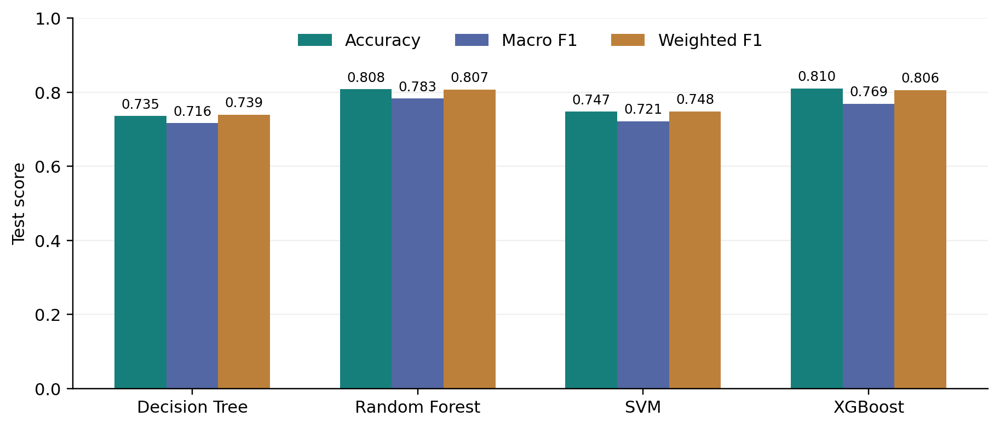
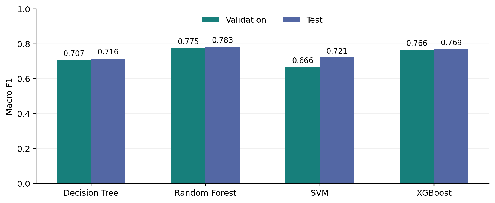
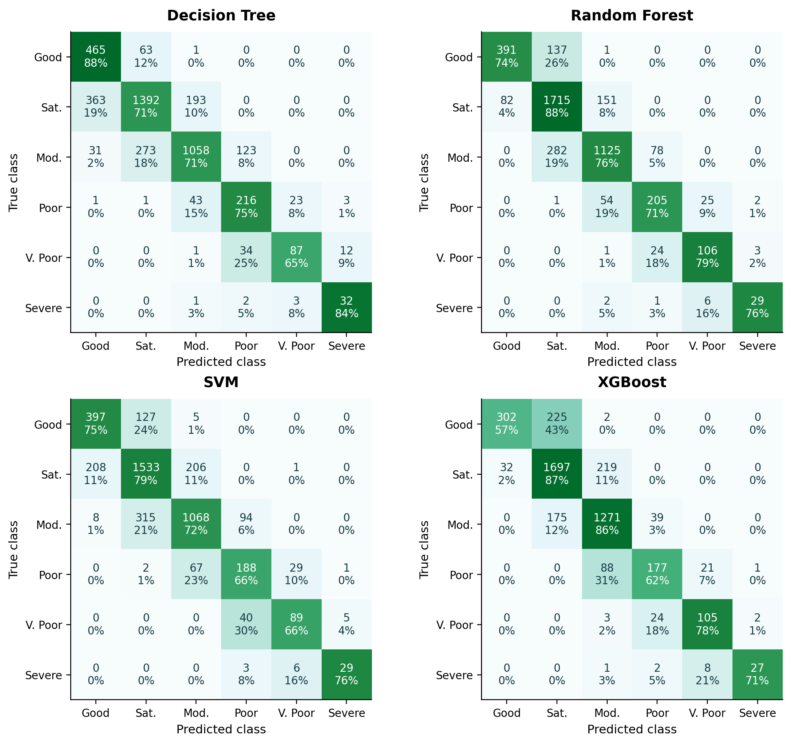
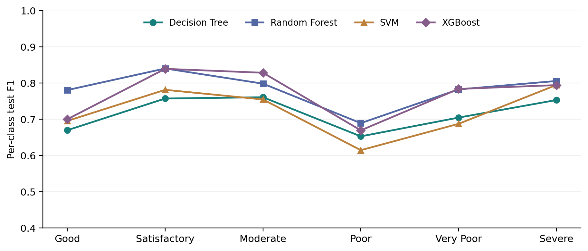
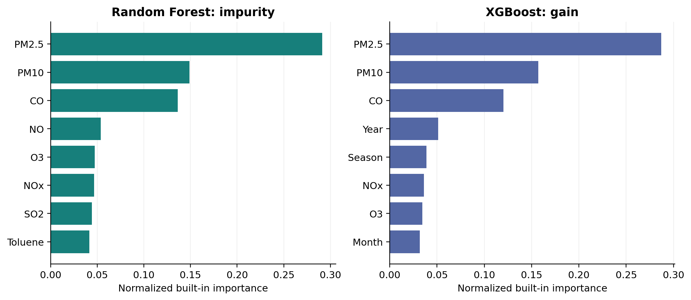
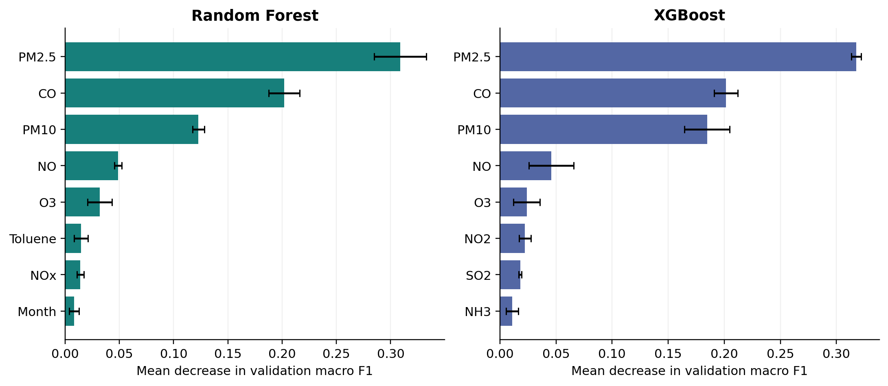
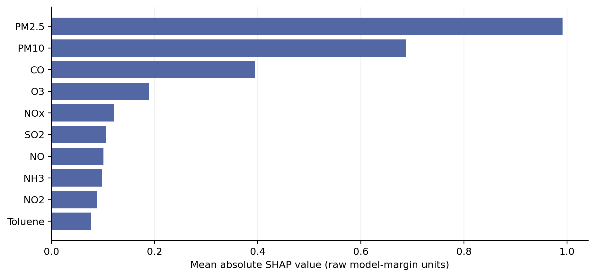

# AirSense results, interpretation and limitations

## 11. Results and Discussion

### Baseline test comparison

*Table 7. Actual test metrics for the four baselines; P and R denote precision and recall. Scores are proportions rounded to four decimals.*

| Model | Accuracy | Macro P | Macro R | Macro F1 | Weighted F1 |
| --- | --- | --- | --- | --- | --- |
| Decision Tree | 0.7351 | 0.6980 | 0.7583 | 0.7162 | 0.7394 |
| Random Forest | 0.8077 | 0.7942 | 0.7743 | 0.7826 | 0.8070 |
| SVM | 0.7473 | 0.7226 | 0.7232 | 0.7212 | 0.7484 |
| XGBoost | 0.8095 | 0.8218 | 0.7348 | 0.7690 | 0.8057 |

Table 7 and Figures 2-3 compare the baseline scores. The validation-selected Random Forest reaches accuracy 0.8077, macro F1 0.7826 and weighted F1 0.8070. Baseline XGBoost has slightly higher accuracy (0.8095) but lower macro F1 (0.7690). Accuracy therefore ranks XGBoost above RF, whereas macro F1 reverses that ordering. This is a practical metric trade-off, not statistical evidence that one model is universally superior. Macro F1 was selected before inspecting these corrected test results because every AQI category should contribute equally.

*Figure 2. Baseline test accuracy, macro F1 and weighted F1 calculated from the saved test predictions. The common score axis makes the accuracy/F1 trade-off visible.*

*Figure 3. Baseline validation and test macro F1. Different period/class mixtures mean a higher test score need not indicate reduced overfitting or better future robustness.*

The majority test class, Satisfactory, contains 1,948/4,421 observations (44.06%). An always-Satisfactory reference computed from these labels would attain that accuracy, but its six-class macro F1 would be only 0.1020. This is a descriptive class-frequency reference, not an additional fitted model or a hyperparameter-selection input.

### Per-class behavior and confusion matrices

*Table 8. Per-class test performance of the frozen baseline Random Forest.*

| Class | Precision | Recall | F1 | Support |
| --- | --- | --- | --- | --- |
| Good | 0.8266 | 0.7391 | 0.7804 | 529 |
| Satisfactory | 0.8033 | 0.8804 | 0.8401 | 1948 |
| Moderate | 0.8433 | 0.7576 | 0.7982 | 1485 |
| Poor | 0.6656 | 0.7143 | 0.6891 | 287 |
| Very Poor | 0.7737 | 0.7910 | 0.7823 | 134 |
| Severe | 0.8529 | 0.7632 | 0.8056 | 38 |

Table 8 and Figure 5 expose per-class differences. Poor has the lowest RF F1 (0.6891), with recall 0.7143. It also has the lowest mean F1 across the four baselines (0.6563). Satisfactory is easier by mean baseline F1 (0.8044), but its higher frequency also makes its performance influential in accuracy and weighted F1. These values are measured on this test period and should not be interpreted as intrinsic difficulty rankings of AQI categories.

The Severe class contains only 38 test observations. RF correctly identifies 29 and misses 9, producing recall 29/38 = 0.7632. One additional Severe-class error would change recall by 1/38, about 2.63 percentage points. A seemingly strong point estimate therefore rests on a small sample, and no confidence interval or significance test is provided.

*Table 9. Measured error patterns from the same baseline confusion matrices.*

| Model | Errors | Adjacent-category errors | Largest confusion | Count |
| --- | --- | --- | --- | --- |
| Decision Tree | 1171 | 1130/1171 (96.5%) | Satisfactory -> Good | 363 |
| Random Forest | 850 | 842/850 (99.1%) | Moderate -> Satisfactory | 282 |
| SVM | 1117 | 1097/1117 (98.2%) | Moderate -> Satisfactory | 315 |
| XGBoost | 842 | 833/842 (98.9%) | Good -> Satisfactory | 225 |

Table 9 and Figure 4 make the error counts explicit. For RF, 842 of 850 errors are between adjacent ordinal categories; its largest confusion is Moderate -> Satisfactory (282 city-days). RF underestimates severity on 453 observations and overestimates it on 397. XGBoost instead has 333 underestimates and 509 overestimates; its largest error pair is Good -> Satisfactory (225). Baseline XGBoost makes eight fewer errors overall, yet RF has the better equal-class balance. Confusion matrices alone do not prove that errors occur near numeric AQI breakpoints; that would require a separate distance-to-boundary audit.

*Figure 4. All four baseline test confusion matrices. Cells show counts and true-class-row percentages. Abbreviations: Sat.=Satisfactory, Mod.=Moderate, V. Poor=Very Poor. Rows are true categories and columns are predictions; darker cells have larger row shares.*

*Figure 5. Test F1 by AQI category for each baseline. Lines guide category-to-category comparisons; they do not represent temporal trajectories.*

### Tuning outcomes and computational cost

*Table 10. Baseline versus tuned macro F1. Validation deltas determine whether tuning helped selection; test values remain descriptive.*

| Model | Baseline val F1 | Tuned val F1 | Delta val F1 | Baseline test F1 | Tuned test F1 |
| --- | --- | --- | --- | --- | --- |
| Decision Tree | 0.7068 | 0.7166 | +0.0098 | 0.7162 | 0.7184 |
| Random Forest | 0.7749 | 0.7737 | -0.0012 | 0.7826 | 0.7724 |
| SVM | 0.6664 | 0.6609 | -0.0055 | 0.7212 | 0.7261 |
| XGBoost | 0.7661 | 0.7617 | -0.0044 | 0.7690 | 0.7640 |

Tables 10-12 separate validation selection, test description and computational cost. Only the Decision Tree improves on validation within this bounded search. The baseline RF remains preferred after considering all eight candidates. The tuned SVM modestly improves test macro F1 despite worse validation macro F1; choosing it because of that test gain would violate the selection protocol. Negative tuning deltas are retained rather than hidden. A six-candidate search does not establish that the optimal configuration has been found.

*Table 11. Actual tuning search/refit costs and best within-search CV scores. SVM CV uses a smaller data subset and different observed date windows; its CV score is not a matched-budget comparison.*

| Model | Search rows | Best CV F1 | Search time (s) | Final refit (s) |
| --- | --- | --- | --- | --- |
| Decision Tree | 16645 | 0.5992 | 3.24 | 0.46 |
| Random Forest | 16645 | 0.6856 | 54.44 | 13.85 |
| SVM | 6000 | 0.5908 | 6.24 | 7.09 |
| XGBoost | 16645 | 0.6538 | 43.47 | 4.04 |

*Table 12. Baseline fit and inference times. Inference is a whole-test batch of 4,421 rows, including preprocessing.*

| Model | Full fit (s) | Batch inference (s) | Batch average (ms/row) |
| --- | --- | --- | --- |
| Decision Tree | 0.232 | 0.008 | 0.0018 |
| Random Forest | 4.789 | 0.142 | 0.0322 |
| SVM | 6.103 | 4.097 | 0.9268 |
| XGBoost | 5.601 | 0.213 | 0.0483 |

SVM has the largest batch inference cost in this run. The timing record does not preserve physical CPU model, available memory, contention or repeated fit variability; these are single-environment descriptive measurements. No hardware-normalized speed or scaling claim is justified.

### Relation to the research motivation

The results support a narrow conclusion: saved tree ensembles handle this incomplete tabular classification task better than the single tree and RBF SVM by macro F1 in the observed partitions. They do not support future forecasting, causal pollutant attribution, deployment safety, or superiority over published systems. The survey is used as contextual literature; its datasets and prediction targets are not a directly comparable leaderboard.

## 12. Feature Importance and Interpretability

The saved analysis concerns the **baseline** RF and XGBoost models. Built-in importance uses their fitted training structures. Permutation uses the same seeded subset of 500 validation rows with three shuffles per feature, scored by six-class macro F1. XGBoost interventional TreeSHAP uses 80 training background rows and 120 validation explanation rows; mean absolute values are averaged across rows and classes in raw model-margin units. These sample counts come from the saved sampling manifest, not generic defaults. RF SHAP was not attempted within the bounded compute budget.

*Figure 6. Built-in top-eight feature importance for baseline RF and XGBoost. Both are normalized within the model, but impurity and gain use different definitions and should not be treated as interchangeable causal effect sizes.*

*Figure 7. Top-eight validation permutation importances. Error bars are the standard deviation across three shuffles, not statistical confidence intervals; each model uses the same 500-row held-out sample.*

*Table 13. Selected actual feature-analysis values. Permutation columns are mean decreases in macro F1; SHAP uses raw margin units and is not on the same scale.*

| Feature | RF permutation drop | XGB permutation drop | XGB mean abs. SHAP |
| --- | --- | --- | --- |
| PM2.5 | 0.3089 | 0.3177 | 0.9913 |
| CO | 0.2018 | 0.2014 | 0.3947 |
| PM10 | 0.1228 | 0.1847 | 0.6870 |
| NO | 0.0487 | 0.0457 | 0.1010 |
| O3 | 0.0319 | 0.0238 | 0.1894 |

Figures 6-8 and Table 13 compare the saved importance methods. PM2.5 ranks first in both permutation analyses; CO and PM10 follow in that order. XGBoost SHAP ranks PM2.5, PM10 and CO first, second and third, showing agreement on a small influential set without identical ordering. For example, RF permutation drops by 0.3089 when PM2.5 is shuffled, versus 0.2018 for CO and 0.1228 for PM10. These are score changes on the particular validation subset, not pollutant contribution percentages or intervention effects.

*Figure 8. Top-ten mean absolute XGBoost SHAP attributions, computed from the saved 80-row training background and 120-row validation explanation sample. Absolute averaging suppresses direction and individual-sample differences.*

Correlated pollutant variables can carry overlapping information; one may substitute when another is shuffled, and interventional SHAP relies on a reference/dependence assumption. The predictor set is also tied to the AQI label definition. Therefore, strong PM2.5 importance does not quantify a causal benefit from reducing PM2.5, identify an emission source or establish a geographic policy effect. Location importance cannot be evaluated because City is excluded. Calendar attribution, if present, must not be described as measured weather influence.

## 13. Limitations

**Retrospective test exposure.** Earlier project work and the audit had already inspected test results. Corrected code can prevent further selection leakage but cannot make the same data historically unseen. A fresh external evaluation is the highest-priority outstanding requirement.

**Mixed temporal and spatial change.** The test includes 919 rows from six cities absent in training. Without paired same-city and deliberately city-disjoint analyses, changes cannot be attributed uniquely to time or geography. Shared-date CV and a seven-day gap do not remove longer autocorrelation or correlated monitoring conditions.

**Target and information availability.** Same-day pollutant measurements are closely related to the supplied AQI label. This is easier and fundamentally different from forecasting. AQI-derived input columns are excluded, but no prospective feature-availability study or independent sensor/unit audit has been performed. Values beyond the official published AQI scale remain a source-quality concern.

**Missingness and preprocessing.** Many records depend on imputation; Xylene is missing in 62.91% of training rows, PM10 in 38.66% and NH3 in 33.22%. Missingness may be informative and nonrandom, yet explicit missingness features are not used. Clipping can remove meaningful extremes. Applying it to calendar numerics also clips 2020 Year values to 2019; cyclic encoding and ablations were not evaluated.

**Imbalance and uncertainty.** Severe has 38 test examples; rare-class recalls can change substantially with a few observations. No confidence intervals, repeated seeds, blocked bootstrap, significance testing or cost-sensitive ordinal evaluation is included. The observed differences must not be advertised as statistically established superiority.

**Search and fairness of budgets.** Only six candidates per model were tried. SVM's smaller CV subset has different date windows and cannot be treated as a perfectly matched full-data tuning comparison. Single validation-period selection may favor a particular seasonal mixture. The search does not establish a global optimum.

**Interpretability and deployment.** Validation is used for selection and exploratory feature analysis, so importance findings are not an independent confirmation. SHAP and permutation use small samples, and their stability is unmeasured. Weather is absent; probabilities are uncalibrated; SVM probabilities are unavailable. No prospective deployment, clinical/public-health decision validation, calibrated uncertainty, new-city guarantee or operational scaling study is provided.
