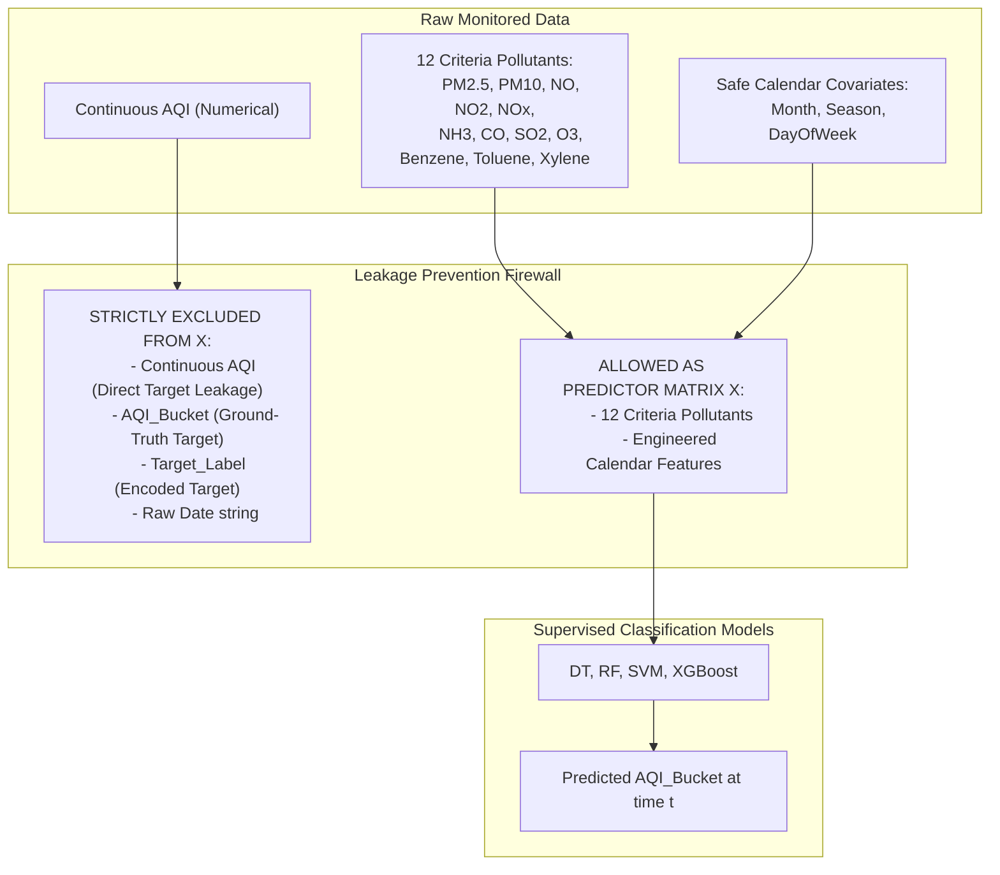
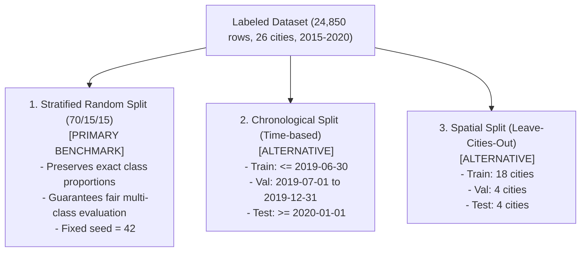

# AirSense — Target Definition, Provenance & Data Splitting Report

**Project:** AirSense — Air Quality Prediction and Analysis Using Machine Learning  
**Target Variable:** `AQI_Bucket` (6-class ordinal categorical)  
**Regulatory Standard:** Central Pollution Control Board (CPCB) National Air Quality Index (NAQI) Standard (2014/2015)  
**Primary Dataset:** `city_day.csv` (India Air Quality, 2015–2020)  
**Modules Created:** `src/target_definition.py`, `src/data_split.py`  
**Test Suite:** `tests/test_target_definition.py`  

---

## 1. Target Availability & Schema Inspection

A thorough inspection of the primary dataset (`city_day.csv`, $N=29,531$) confirms that **both the continuous numeric index (`AQI`) and the categorical advisory tier (`AQI_Bucket`) are present**:

| Field Name | Inferred Dtype | Total Records | Valid Records | Null Records | Missingness % | Role in AirSense |
| :--- | :--- | :--- | :--- | :--- | :--- | :--- |
| `AQI` | `float64` | 29,531 | 24,850 | 4,681 | 15.85% | Continuous target / **Strictly excluded from $X$** |
| `AQI_Bucket` | `object` | 29,531 | 24,850 | 4,681 | 15.85% | **Primary Ground-Truth Target Label** |

### Empirical Validation Findings:
1. **Target Completeness & Perfect Correspondence:**
   Whenever `AQI` is present, `AQI_Bucket` is present; whenever `AQI` is missing, `AQI_Bucket` is missing (exactly **0 mismatches** across all 29,531 rows).
2. **Missing Target Handling:**
   In accordance with regulatory principles, observations missing target labels (4,681 rows, 15.85%) are **strictly filtered out rather than imputed**. Under CPCB guidelines, when fewer than three pollutants are monitored or when neither $PM_{2.5}$ nor $PM_{10}$ is recorded, AQI is legally undefined. Retaining 24,850 ground-truth observations ensures all downstream evaluations rest on verified measurements.
3. **Label Sanitation & Consistency:**
   An audit of all unique text strings in `AQI_Bucket` revealed **0 invalid labels**, **0 whitespace errors**, and **0 case inconsistencies**. Every valid record maps directly to one of the six standard CPCB categories:
   - `Good`: 1,341 rows (5.40%)
   - `Satisfactory`: 8,224 rows (33.09%)
   - `Moderate`: 8,829 rows (35.53%)
   - `Poor`: 2,781 rows (11.19%)
   - `Very Poor`: 2,337 rows (9.40%)
   - `Severe`: 1,338 rows (5.38%)

---

## 2. Regulatory Provenance & CPCB Standards

The `AQI_Bucket` column directly reflects the official **National Air Quality Index (NAQI)** framework established by the **Central Pollution Control Board (CPCB)**, Ministry of Environment, Forest and Climate Change (MoEFCC), Government of India (Report published in October 2014, operationalized nationally in April 2015).

### 2.1 CPCB Calculation Methodology
For each criteria pollutant $p$, a sub-index $I_p$ is computed from its observed concentration $C_p$ using piecewise linear interpolation between defined concentration breakpoints:

$$I_p = I_{lo} + \frac{I_{hi} - I_{lo}}{B_{hi} - B_{lo}} (C_p - B_{lo})$$

where:
- $[B_{lo}, B_{hi}]$ represents the concentration breakpoint bracket encompassing $C_p$.
- $[I_{lo}, I_{hi}]$ represents the corresponding sub-index score range.

The composite $\text{AQI}$ is the **maximum sub-index** across all monitored pollutants:

$$\text{AQI} = \max(I_1, I_2, \dots, I_k)$$

**Regulatory Conditions:**
1. At least three criteria pollutants must be monitored.
2. At least one of the monitored pollutants must be either $PM_{2.5}$ or $PM_{10}$.
3. For daily aggregates, at least 16 hourly readings are required.

### 2.2 Breakpoint Table & Category Thresholds
The aggregate $\text{AQI}$ maps to the six official health advisory categories as follows:

| AQI Range | CPCB Category | Primary Health Impact Description (CPCB 2014) |
| :--- | :--- | :--- |
| **0 – 50** | **Good** | Minimal impact. |
| **51 – 100** | **Satisfactory** | Minor breathing discomfort to sensitive people. |
| **101 – 200** | **Moderate** | Breathing discomfort to people with lungs, asthma, and heart diseases. |
| **201 – 300** | **Poor** | Breathing discomfort to most people on prolonged exposure. |
| **301 – 400** | **Very Poor** | Respiratory illness on prolonged exposure. |
| **401 – 500+** | **Severe** | Affects healthy people and seriously impacts those with existing diseases. |

### 2.3 Mathematical Derivation Verification
To confirm that `AQI_Bucket` adheres strictly to CPCB rules, we executed `src.target_definition.aqi_to_cpcb_bucket()` across all 24,850 rows.
- **Result:** **0 mismatches** between the derived CPCB category and the documented `AQI_Bucket` column. The dataset categories are 100% faithful to the official standard.

---

## 3. Critical Data Leakage Audit & Guardrails

### 3.1 The Continuous `AQI` Leakage Threat
Because `AQI_Bucket` is an exact piecewise threshold function of `AQI`:
- If `AQI` were included in feature matrix $X$, a simple Decision Tree would split at $[50, 100, 200, 300, 400]$ and achieve $100\%$ accuracy trivializing the problem.
- **Enforced Safeguard:** In `src/target_definition.py` (`prepare_feature_target_matrices`), `AQI` is **hard-coded into `LEAKAGE_COLUMNS` and automatically purged** from feature matrix $X$. An automated assertion raises a `ValueError` if `AQI` is ever passed into model inputs.

### 3.2 What the Models Are Learning (Reproducing Rules vs. Forecasting)
Because the ground-truth `AQI_Bucket` was originally computed by CPCB from monitored pollutants:
- When a classifier predicts `AQI_Bucket` from the 12 criteria pollutants, it is learning an **empirical statistical approximation of the multi-pollutant CPCB sub-index aggregation function**.
- It learns how complex, incomplete multi-pollutant matrices (where some sensors are missing) map to public health warning tiers.
> [!IMPORTANT]
> **This diagnostic classification is NEVER presented as proof of forecasting future pollution.** It represents automated categorization and health-risk assessment of current air quality observations at time $t$.

---

## 4. Evaluation of Data Splitting Strategies

To ensure reproducibility and rigorous evaluation, we implemented three distinct splitting strategies in `src/data_split.py`:

### Comparative Analysis of Splitting Approaches:

| Strategy | Methodology | Train / Val / Test Splits | Key Advantages | Limitations & Biases | Recommended Use |
| :--- | :--- | :--- | :--- | :--- | :--- |
| **Stratified Split** | Random stratified sampling across all 6 classes (Seed: 42) | **Train:** 17,394 (70.0%) **Val:** 3,728 (15.0%) **Test:** 3,728 (15.0%) | Guarantees identical representation of rare classes (`Good`: 5.4%, `Severe`: 5.4%) in every fold; enables fair, unbiased multi-class algorithmic comparison. | Assumes i.i.d. observations; adjacent days in the same city may share localized autocorrelation. | **Primary Benchmark** (All 4 models evaluated here) |
| **Chronological Split** | Temporal cutoff based on `Date` (Train $\le$ Jun 2019, Val = H2 2019, Test $\ge$ 2020) | **Train:** 16,339 (65.75%) **Val:** 3,831 (15.42%) **Test:** 4,680 (18.83%) | Strictly respects the arrow of time; evaluates historical-to-future generalization. | Vulnerable to secular distribution shifts: in 2020, India experienced strict nationwide COVID-19 lockdowns, causing unprecedented drops in urban pollution that alter class distributions. | Supplementary temporal validation |
| **Spatial Split** | Grouped by City (Leave-Cities-Out) (Train: 18 cities, Val: 4, Test: 4) | **Train:** 18,740 (75.4%) **Val:** 1,090 (4.4%) **Test:** 5,020 (20.2%) | Tests geographic transferability to cities without CAAQMS infrastructure. | Extreme regional climate heterogeneity: mountain cities (Aizawl, Shillong) have zero Severe days, while Delhi has 20% Severe days. City counts vary from 100 to 2,000 rows. | Supplementary regional transferability analysis |

### 4.1 Selection & Justification of Primary Strategy
AirSense designates the **Stratified Random Split (70% Train, 15% Val, 15% Test)** as the primary evaluation strategy for the core 4-model comparison because:
1. **Critical Class Representation:** With `Severe` and `Good` days comprising only $\sim 5.4\%$ each, chronological or grouped splits result in volatile, non-representative test sets where minority classes can be entirely absent or heavily over-represented. Stratified splitting guarantees that all 6 categories have sufficient test samples for statistically meaningful Macro F1-Score evaluation.
2. **Reproducibility:** A fixed random seed (`42`) guarantees 100% deterministic reproducibility across platforms.

---

## 5. Audit of Processed Datasets

All three split partitions have been persisted to disk under `data/processed/` without altering original raw files:
- **Primary Stratified Splits:** [`data/processed/stratified/`](file:///c:/dev/AirSense/data/processed/stratified/) (`train.csv`, `val.csv`, `test.csv`)
- **Temporal Splits:** [`data/processed/temporal/`](file:///c:/dev/AirSense/data/processed/temporal/) (`train.csv`, `val.csv`, `test.csv`)
- **Spatial Splits:** [`data/processed/spatial/`](file:///c:/dev/AirSense/data/processed/spatial/) (`train.csv`, `val.csv`, `test.csv`)

### Verification Checklist:
- [x] Schema inspected; continuous `AQI` and categorical `AQI_Bucket` confirmed available.
- [x] All 6 labels validated against CPCB 2014 standards; 0 invalid labels and 0 label mismatches.
- [x] Regulatory provenance and breakpoint formulas documented with official citations.
- [x] Critical leakage check: `AQI` purged from feature space $X$ with automated detection safeguards.
- [x] Explicitly noted that classifying current conditions from pollutants is not future forecasting.
- [x] Stratified split chosen as primary benchmark; chronological and spatial alternatives implemented and audited.
- [x] All 24 unit tests passing cleanly in test suite.

