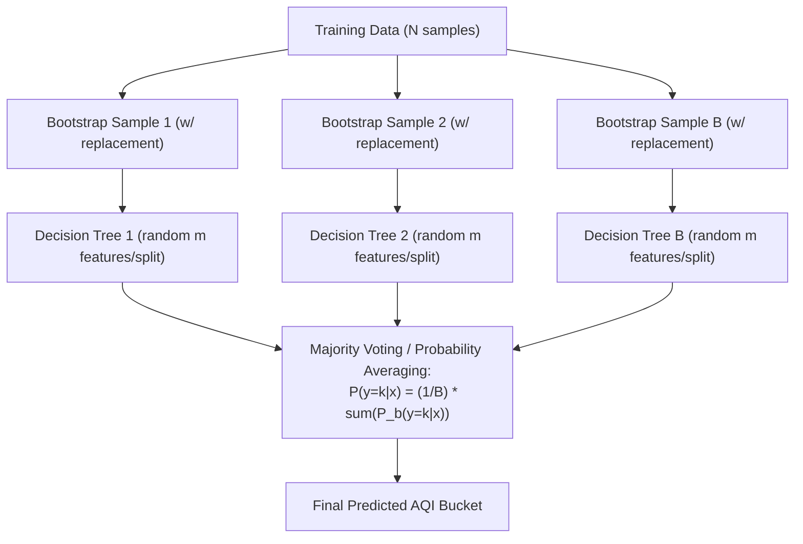

# AirSense — Theoretical Background & Algorithmic Foundations

**Project:** AirSense — Air Quality Prediction and Analysis Using Machine Learning  
**Target Domain:** Multi-Class Environmental Air Quality Classification  
**Target Models:** Decision Tree, Random Forest, Support Vector Machine (SVM), XGBoost  
**Evaluation Framework:** Multi-Class Classification Metrics & Numerical Regression Extension Formulations  

---

## 1. Algorithmic Formulations

### 1.1 Decision Tree Classifier (DT)

#### Fundamental Principle
A Decision Tree (Quinlan, 1986) is a non-parametric supervised learning algorithm that partitions the feature space $\mathcal{X} \subset \mathbb{R}^d$ into a set of non-overlapping, axis-aligned hyper-rectangles $\{R_m\}_{m=1}^M$ using a sequence of recursive binary decision rules. In each region $R_m$, the target class is predicted by the majority class distribution among training samples in that leaf.

#### Mathematical Splitting Criteria
At each internal node, the algorithm searches over all available features $j \in \{1, \dots, d\}$ and all possible split thresholds $s$ to partition the local dataset $Q$ into subsets $Q_{left}(j, s) = \{\mathbf{x} \mid x_j \le s\}$ and $Q_{right}(j, s) = \{\mathbf{x} \mid x_j > s\}$.

The split is selected to maximize the **reduction in impurity**:

$$\Delta I(Q, j, s) = I(Q) - \left( \frac{|Q_{left}|}{|Q|} I(Q_{left}) + \frac{|Q_{right}|}{|Q|} I(Q_{right}) \right)$$

where $I(Q)$ denotes the node impurity. Two primary impurity metrics are utilized:

1. **Gini Impurity (Default):**
   $$I_G(Q) = 1 - \sum_{k=1}^K p_{mk}^2$$
   where $p_{mk} = \frac{1}{|Q|} \sum_{\mathbf{x}_i \in Q} \mathbb{I}(y_i = k)$ is the empirical proportion of class $k$ in node $m$.
2. **Shannon Entropy (Information Gain):**
   $$I_E(Q) = - \sum_{k=1}^K p_{mk} \log_2(p_{mk})$$

#### Strengths & Weaknesses in Air Quality Classification
- **Strengths:** High interpretability; generates human-readable decision rules (e.g., "If $PM_{2.5} > 120\,\mu\text{g}/\text{m}^3$ and $CO > 2.0\,\text{mg}/\text{m}^3$, then class is `Very Poor`"); invariant to monotonic feature scaling; handles mixed feature types naturally.
- **Weaknesses:** High variance; small perturbations in the dataset can produce drastically different tree structures; prone to severe overfitting if depth is unconstrained (`max_depth=None`); creates orthogonal step-wise decision boundaries that struggle with diagonal linear boundaries.

---

### 1.2 Random Forest Classifier (RF)

#### Fundamental Principle
Introduced by Leo Breiman (2001), Random Forest is an ensemble learning method based on **Bagging (Bootstrap Aggregation)** and the **Random Subspace Method**. It builds a large collection of de-correlated decision trees $\{h_b(\mathbf{x})\}_{b=1}^B$ and aggregates their predictions via majority voting.

#### Variance Reduction Mechanics
For an ensemble of $B$ identically distributed, unbiased estimators with pairwise correlation $\rho$ and individual variance $\sigma^2$, the variance of the ensemble mean is:

$$\text{Var}\left(\frac{1}{B}\sum_{b=1}^B h_b(\mathbf{x})\right) = \rho \sigma^2 + \frac{1 - \rho}{B} \sigma^2$$

As $B \to \infty$, the second term approaches zero, leaving $\rho \sigma^2$. To minimize the total variance, Random Forest actively reduces inter-tree correlation $\rho$ by:
1. Training each tree on an independently drawn bootstrap sample of size $N$ (drawn with replacement). Approximately $63.2\%$ of unique samples appear in each bootstrap sample; the remaining $36.8\%$ form the **Out-Of-Bag (OOB)** evaluation set.
2. At every candidate split, selecting the best split feature strictly from a randomly sampled feature subset of size $m = \lfloor\sqrt{d}\rfloor$. This prevents a single dominant pollutant (such as $PM_{2.5}$) from dictating the root split of every tree.

#### Handling Class Imbalance
In our imbalanced Indian dataset (`Moderate` and `Satisfactory` dominate), standard Random Forest can be biased toward majority classes. We implement **Balanced Random Forest**, which adjusts sample weights inversely proportional to class frequencies:

$$w_k = \frac{N}{K \cdot N_k}$$

where $N$ is total samples, $K=6$ is the number of CPCB classes, and $N_k$ is the sample count of class $k$.

---

### 1.3 Support Vector Machine (SVM)

#### Fundamental Principle
Developed by Vladimir Vapnik and Corinna Cortes (1995), Support Vector Machines construct an optimal decision hyperplane in a high-dimensional feature space that maximizes the geometric **margin** of separation between classes.

#### Mathematical Formulation (Binary Soft-Margin)
For training instances $(\mathbf{x}_i, y_i)$ with $y_i \in \{-1, +1\}$, the soft-margin primal optimization problem is:

$$\min_{\mathbf{w}, b, \boldsymbol{\xi}} \frac{1}{2} \|\mathbf{w}\|^2 + C \sum_{i=1}^N \xi_i$$

subject to the constraints:

$$y_i (\mathbf{w}^T \phi(\mathbf{x}_i) + b) \ge 1 - \xi_i, \quad \xi_i \ge 0, \quad \forall i \in \{1, \dots, N\}$$

where:
- $\mathbf{w}$ is the weight vector normal to the separating hyperplane,
- $b$ is the bias intercept,
- $\xi_i$ are slack variables allowing margin violations for non-linearly separable data,
- $C > 0$ is the regularization parameter governing the trade-off between margin width ($\frac{2}{\|\mathbf{w}\|}$) and classification error penalties,
- $\phi(\mathbf{x})$ is a non-linear mapping function.

#### The Kernel Trick & Radial Basis Function (RBF)
Applying the Wolfe dual formulation replaces inner products with a kernel function $K(\mathbf{x}_i, \mathbf{x}_j) = \langle\phi(\mathbf{x}_i), \phi(\mathbf{x}_j)\rangle$. For environmental modeling, the **Radial Basis Function (RBF / Gaussian) Kernel** is preferred:

$$K(\mathbf{x}_i, \mathbf{x}_j) = \exp\left( -\gamma \|\mathbf{x}_i - \mathbf{x}_j\|^2 \right)$$

where $\gamma = \frac{1}{2\sigma^2}$ determines the radius of influence of individual support vectors.

#### Multi-Class Extension & Preprocessing Requirements
Because SVM is inherently binary, multi-class classification for 6 CPCB categories is implemented via **One-vs-Rest (OvR)** or **One-vs-One (OvO)**:
- **One-vs-Rest (OvR):** Trains $K=6$ distinct binary classifiers, each separating class $k$ from all other $K-1$ classes. The predicted class is $\hat{y} = \arg\max_{k} f_k(\mathbf{x})$.
- **Scaling Sensitivity:** SVM computes Euclidean distances $\|\mathbf{x}_i - \mathbf{x}_j\|^2$ between pollutant vectors. If features with large numeric magnitudes (e.g., $PM_{10} \in [0, 1000]$) are not standardized, they will completely dominate features with small magnitudes (e.g., $CO \in [0, 10]$ or $Benzene \in [0, 20]$). Robust scaling ($\frac{x - Q_2}{Q_3 - Q_1}$) or standard scaling ($\frac{x - \mu}{\sigma}$) is mathematically required.

---

### 1.4 Extreme Gradient Boosting (XGBoost)

#### Fundamental Principle
XGBoost (Chen & Guestrin, 2016) is a scalable, highly regularized implementation of Gradient Boosted Decision Trees (GBDT). Unlike Random Forest (which builds independent trees in parallel), XGBoost constructs trees sequentially in an additive manner, where each subsequent tree $f_t(\mathbf{x})$ fits the negative gradient (pseudo-residuals) of the loss function evaluated by the ensemble up to step $t-1$:

$$\hat{y}_i^{(t)} = \hat{y}_i^{(t-1)} + \eta f_t(\mathbf{x}_i)$$

where $\eta \in (0, 1]$ is the shrinkage learning rate.

#### Regularized Objective & Second-Order Approximation
At step $t$, the regularized objective function is:

$$\mathcal{L}^{(t)} = \sum_{i=1}^N l\left(y_i, \hat{y}_i^{(t-1)} + f_t(\mathbf{x}_i)\right) + \Omega(f_t)$$

The tree complexity penalty $\Omega(f_t)$ penalizes the number of leaves $T$ and the magnitude of leaf weights $\mathbf{w} \in \mathbb{R}^T$:

$$\Omega(f_t) = \gamma T + \frac{1}{2} \lambda \sum_{j=1}^T w_j^2 + \alpha \sum_{j=1}^T |w_j|$$

Applying a second-order Taylor expansion around the current prediction $\hat{y}_i^{(t-1)}$:

$$\mathcal{L}^{(t)} \approx \sum_{i=1}^N \left[ l(y_i, \hat{y}_i^{(t-1)}) + g_i f_t(\mathbf{x}_i) + \frac{1}{2} h_i f_t^2(\mathbf{x}_i) \right] + \Omega(f_t)$$

where:
- First-order gradient: $g_i = \partial_{\hat{y}^{(t-1)}} l(y_i, \hat{y}^{(t-1)})$,
- Second-order Hessian: $h_i = \partial^2_{\hat{y}^{(t-1)}} l(y_i, \hat{y}^{(t-1)})$.

#### Optimal Leaf Weights & Split Finding
Let $I_j = \{i \mid q(\mathbf{x}_i) = j\}$ be the index set of instances assigned to leaf $j$. The optimal leaf weight $w_j^*$ and the corresponding optimal objective value are given by:

$$w_j^* = - \frac{\sum_{i \in I_j} g_i}{\sum_{i \in I_j} h_i + \lambda}, \qquad \mathcal{L}_{opt}^{(t)} = - \frac{1}{2} \sum_{j=1}^T \frac{\left( \sum_{i \in I_j} g_i \right)^2}{\sum_{i \in I_j} h_i + \lambda} + \gamma T$$

When splitting a leaf into left ($I_L$) and right ($I_R$) sub-regions with $I = I_L \cup I_R$, the **gain** of the split is:

$$\text{Gain} = \frac{1}{2} \left[ \frac{\left(\sum_{i \in I_L} g_i\right)^2}{\sum_{i \in I_L} h_i + \lambda} + \frac{\left(\sum_{i \in I_R} g_i\right)^2}{\sum_{i \in I_R} h_i + \lambda} - \frac{\left(\sum_{i \in I} g_i\right)^2}{\sum_{i \in I} h_i + \lambda} \right] - \gamma$$

A split is executed only if $\text{Gain} > 0$, providing an intrinsic pre-pruning mechanism controlled by $\gamma$.

For multi-class classification across the 6 CPCB categories, XGBoost optimizes the multi-class logarithmic loss (`multi:softprob`):

$$l(\mathbf{y}_i, \mathbf{p}_i) = - \sum_{k=1}^K y_{ik} \ln(p_{ik}), \quad p_{ik} = \frac{e^{\hat{y}_{ik}}}{\sum_{j=1}^K e^{\hat{y}_{ij}}}$$

---

## 2. Multi-Class Classification Metrics

To evaluate model performance fairly across imbalanced categories, we define the standard suite of multi-class metrics derived from the multi-class **Confusion Matrix**.

### 2.1 The Multi-Class Confusion Matrix
For $K = 6$ classes, the confusion matrix $\mathbf{C} \in \mathbb{Z}^{K \times K}$ has elements $C_{ij}$ representing the number of observations known to belong to ground-truth class $i$ that were predicted as class $j$:

$$\mathbf{C} = \begin{pmatrix}
C_{\text{Good}, \text{Good}} & C_{\text{Good}, \text{Satisfactory}} & \dots & C_{\text{Good}, \text{Severe}} \\
C_{\text{Satisfactory}, \text{Good}} & C_{\text{Satisfactory}, \text{Satisfactory}} & \dots & C_{\text{Satisfactory}, \text{Severe}} \\
\vdots & \vdots & \ddots & \vdots \\
C_{\text{Severe}, \text{Good}} & C_{\text{Severe}, \text{Satisfactory}} & \dots & C_{\text{Severe}, \text{Severe}}
\end{pmatrix}$$

- **Diagonal entries ($C_{ii}$):** Correct predictions (True Positives for class $i$).
- **Off-diagonal entries ($C_{ij}, i \ne j$):** Misclassification errors. In ordinal air-quality tiers, misclassifying a `Severe` day as `Very Poor` is a 1-tier error, whereas misclassifying `Severe` as `Good` is a catastrophic multi-tier error that misleads public health advisories.

For each individual class $k \in \{1, \dots, K\}$, we define:
- $\text{TP}_k = C_{kk}$ (True Positives)
- $\text{FP}_k = \sum_{i \ne k} C_{ik}$ (False Positives: instances of other classes incorrectly predicted as class $k$)
- $\text{FN}_k = \sum_{j \ne k} C_{kj}$ (False Negatives: true instances of class $k$ predicted as another class)
- $\text{TN}_k = \sum_{i \ne k} \sum_{j \ne k} C_{ij}$ (True Negatives)

---

### 2.2 Mathematical Metrics

#### Overall Accuracy
$$\text{Accuracy} = \frac{\sum_{k=1}^K C_{kk}}{\sum_{i=1}^K \sum_{j=1}^K C_{ij}} = \frac{\sum_{k=1}^K \text{TP}_k}{N}$$
- *Limitation:* Strongly dominated by majority classes (`Moderate` and `Satisfactory`). A naive classifier predicting only `Moderate` and `Satisfactory` can achieve $> 68\%$ accuracy while failing completely on hazardous `Severe` days.

#### Per-Class Precision
$$\text{Precision}_k = \frac{\text{TP}_k}{\text{TP}_k + \text{FP}_k}$$
- *Interpretation:* The probability that a day predicted as tier $k$ actually belongs to tier $k$. High precision prevents "false alarms" that unnecessarily restrict industrial operations.

#### Per-Class Recall (Sensitivity)
$$\text{Recall}_k = \frac{\text{TP}_k}{\text{TP}_k + \text{FN}_k}$$
- *Interpretation:* The percentage of true tier $k$ days successfully captured by the model. For hazardous tiers (`Severe`, `Very Poor`), **high recall is critical** to ensure dangerous air quality spikes are not missed.

#### Per-Class F1-Score
The harmonic mean of Precision and Recall for class $k$:
$$F_{1, k} = 2 \cdot \frac{\text{Precision}_k \cdot \text{Recall}_k}{\text{Precision}_k + \text{Recall}_k} = \frac{2 \text{TP}_k}{2 \text{TP}_k + \text{FP}_k + \text{FN}_k}$$

#### Macro-Averaged vs. Weighted-Averaged F1-Score
1. **Macro F1-Score (Primary Benchmark Metric):**
   $$\text{Macro } F_1 = \frac{1}{K} \sum_{k=1}^K F_{1, k}$$
   Assigns equal weight to each of the 6 classes regardless of sample size. It penalizes models that fail on minority classes (`Good` and `Severe`).
2. **Weighted F1-Score:**
   $$\text{Weighted } F_1 = \sum_{k=1}^K \left( \frac{N_k}{N} \right) F_{1, k}$$
   Weights each class score by its ground-truth prevalence $N_k / N$.

#### Balanced Accuracy
$$\text{Balanced Accuracy} = \frac{1}{K} \sum_{k=1}^K \text{Recall}_k$$
- Computes the average recall across all classes, serving as the benchmark metric for imbalanced multi-class problems.

---

## 3. Regression Metrics (Relevant to Future Numerical Forecasting Extension)

While the primary AirSense task is 6-category classification, future extensions may forecast continuous numerical pollutant concentrations or aggregate AQI values ($y_t \in \mathbb{R}^+$). The standard regression metrics evaluated in the survey of Méndez et al. (2023) are defined below:

### 3.1 Mean Absolute Error (MAE)
$$\text{MAE} = \frac{1}{n} \sum_{i=1}^n |y_i - \hat{y}_i|$$
- Measures the average absolute magnitude of errors in the original measurement units ($\mu\text{g}/\text{m}^3$ or AQI units).
- Gives linear weight to all individual differences, making it robust to extreme outliers.

### 3.2 Root Mean Squared Error (RMSE)
$$\text{RMSE} = \sqrt{\frac{1}{n} \sum_{i=1}^n (y_i - \hat{y}_i)^2}$$
- Because errors are squared before averaging, RMSE penalizes large errors more heavily than small errors.
- *Relevance in Air Quality:* RMSE is particularly sensitive to severe pollution episodes where predicted concentrations diverge substantially from extreme observed peaks.

### 3.3 Coefficient of Determination ($R^2$)
$$R^2 = 1 - \frac{\sum_{i=1}^n (y_i - \hat{y}_i)^2}{\sum_{i=1}^n (y_i - \bar{y})^2}$$
where $\bar{y} = \frac{1}{n} \sum_{i=1}^n y_i$ is the empirical mean of the ground-truth observations.
- Represents the proportion of variance in the dependent variable explained by the model relative to a trivial baseline predicting the sample mean $\bar{y}$.
- $R^2 = 1$ indicates perfect prediction; $R^2 = 0$ indicates performance equivalent to the mean baseline; $R^2 < 0$ indicates predictions worse than the mean baseline.

